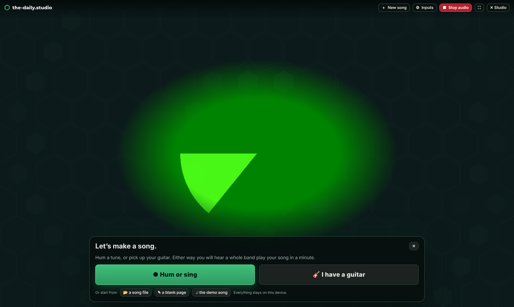
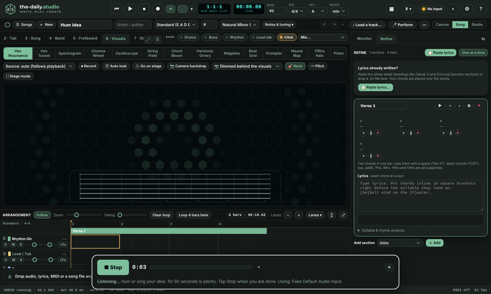

<p align="center">
  <picture><source media="(prefers-color-scheme: dark)" srcset="docs/brand/mark-dark.svg"></picture>
</p>

<h1 align="center">the-daily.studio</h1>
<p align="center"><b>A songwriter’s workspace that lives in one web page.</b><br>
Catch an idea · find the chords · record guitar and vocals · split a track into stems · keep every song on your own device</p>
<p align="center"><sub>MVP 1 · v1.7.0 · free, open source (MIT) · no account, no upload, no tracking</sub></p>

<p align="center">
  <a href="https://the-daily.studio/"><b>▶ Open the live app</b></a> ·
  <a href="docs/USER_GUIDE.md">User guide</a> ·
  <a href="docs/HOSTING.md">Host it yourself</a> ·
  <a href="docs/ARCHITECTURE.md">Architecture</a> ·
  <a href="docs/OPERATIONS.md">Operations</a> ·
  <a href="docs/SECURITY_MODEL.md">Security model</a> ·
  <a href="docs/README.md">All docs</a> ·
  <a href="CONTRIBUTING.md">Contribute</a>
</p>

<p align="center">
  <a href="LICENSE"></a>
  
  
  <a href="https://github.com/TehauD/the-daily.studio/actions/workflows/ci.yml"></a>
</p>

<p align="center">
  
</p>

---

## Contents

[What it is](#what-it-is) · [Highlights](#highlights) · [Quick start](#quick-start) · [Your first five minutes](#your-first-five-minutes) · [Tour of the panels](#tour-of-the-panels) · [Tunings](#tunings) · [Phone and tablet](#phone-and-tablet) · [Keyboard shortcuts](#keyboard-shortcuts) · [Audio setup](#audio-setup) · [Privacy](#privacy-and-data) · [Accuracy and honest limits](#accuracy-and-honest-limits) · [Browser support](#browser-support) · [Project layout](#project-layout) · [Develop](#develop) · [Host it](#host-it-on-your-github) · [Roadmap](#roadmap-ideas) · [License](#license-and-credits)

## What it is

> **Hum a melody. Get a song.** Press **● Hum or sing**, hum 10–30 seconds, and the app finds your notes, key and tempo, writes the chords, builds intro, verses, choruses, bridge and outro, and plays it back with a band, with you on camera center stage if you choose the stage route. Then change the style, edit anything, add lyrics, or record real guitar. No account, no upload, no experience needed. See the [user guide](docs/USER_GUIDE.md#hum-to-song-start-here).

<p align="center"></p>
<p align="center"></p>
<p align="center"></p>
<p align="center"></p>

the-daily.studio is a songwriter's workspace and full guitar workstation that runs **entirely in your browser**: plug in your guitar (or a microphone), choose a tone, and play along with a backing band while the app listens, analyses, transcribes and visualises what you play.

It began as a guitar lab and grew into a place to turn a hum into a finished song. The numbers behind your playing stay available: the numbers behind your playing (pitch to the cent, timing against a click, vibrato, attack harshness, latency) are visible, exportable and honest about their uncertainty.

* **One page, no install, no account, no server.** Open `index.html` or the hosted page and play.
* **Local first.** Audio, video, projects and settings never leave your machine. See [Privacy](#privacy-and-data).
* **Vanilla JavaScript**, Web Audio, AudioWorklet and Canvas/SVG. No framework, no bundler required to *run* it.
* **Any screen.** The layout adapts to phone, tablet and desktop, so you can record or write a song on the device in your hand.
* **Your tuning, your band.** Standard, Eb, C#, Drop D / C# / C / B and more, plus a custom per-string tuning editor, drive every part of the app.

## Highlights

| Area | What you get |
|---|---|
| **Rig** | 16 reorderable effect units (gate, compressor, wah, overdrive, distortion, fuzz, pitch / harmony, amp, cabinet / IR, parametric EQ, chorus, phaser, flanger, tremolo, delay, reverb), 5 amp models, procedural cabinets and impulse-response loading, 6 reverbs, 27 presets, A/B morph, mutate, scenes, per-pedal footswitch keys and MIDI bindings, Stomp view for live use. |
| **Arrangement** | A DAW-style track list: chord, tab, bass and drum lanes, your **Guitar** and **Vocal** inputs, recorded takes, and a loaded track with its four stems, all on one bar grid. Reorder, resize, recolour and hide lanes; arm guitar and vocals and **record both at once** from a two-input interface (guitar on input 1, microphone on input 2). |
| **Song strip** | Title, artist, tuning, capo and scale in one strip above every panel. Load a track and it fills in the title, tempo, key and chords for you. **Refine** (right sidebar) is the shared lyric and chord canvas, and any panel can be moved between the centre and either sidebar. |
| **Band** | Drums, bass, rhythm guitar and lead-tab playback in many styles, always one click away in the band strip. Rehearsal mixes mute whoever you are replacing. |
| **Compose** | Tab editor with techniques (hammer, pull, slides, bends, vibrato, mutes), chord and lyric lanes, automatic voicings for any tuning and capo, Ultimate Guitar-ready text, ChordPro, MIDI, WAV and project JSON export with a submission lint report. |
| **Transcribe** | Record or load audio and get **polyphonic tab** placed on strings and frets for your tuning, with per-note confidence, review and accept / reject, timing auto-align and a built-in self-test. |
| **Stems** | Load a backing track (you can also ship one-tap **sample tracks** by dropping files in `samples/`): separate **drums, bass, vocals and guitar / other**, estimate tempo, key and chords, import the chords into your song, copy the drum groove to the band, and mute stems to play along. |
| **Neural map** | An interactive node graph of the music: notes and harmony take shape as the song progresses. |
| **Stage and visuals** | Audio-reactive full-screen visuals (hex resonance, tunnels, spectrogram, chroma wheel, orrery, ridgeline, prompter) with scenes you can switch from the keyboard or a MIDI controller. |
| **Camera look** | Put yourself in the visuals: dimmed behind them, framed by them (visuals grow in from the edges) or a green-screen style cut-out with the visuals playing behind you. |
| **Research** | YIN pitch tracking with cents, vibrato rate and extent, attack harshness, key and chord detection, timing jitter against the click, loopback latency measurement, session CSV / JSON. |
| **Vision** | Calibrate the neck with your webcam and track the fretting hand (optional MediaPipe), then cross-check finger positions against the notes you actually played. |
| **Safety nets** | Version history with automatic snapshots, calibration to *your* guitar, undo / redo, autosave. |
| **Guided tour** | A spotlight walkthrough of every key area, offered on first run and available from **?**. |
| **Phone, tablet, desktop** | One responsive app. On a phone: bottom transport, five-section navigation, an on-screen tab keypad, pinch-to-zoom Neural map and a wake lock while you play. Installable as an app (PWA). See [Phone and tablet](#phone-and-tablet). |

## Screenshots

<p align="center"><br><sub><b>On a phone</b> · Play (rig and scenes) · Write (tab with keypad while the song plays) · Appearance (looks, palettes, accents)</sub></p>

<table>
  <tr>
    <td width="50%"><br><sub><b>Studio</b> · tone, scenes, signal chain, arrangement and transport (Daily Light)</sub></td>
    <td width="50%"><br><sub><b>Appearance</b> · eight looks, seventeen palettes, accents, type, density and high contrast</sub></td>
  </tr>
  <tr>
    <td><br><sub><b>Canvas</b> · zoom out to see the whole song and rearrange it</sub></td>
    <td><br><sub><b>Songs</b> · every song lives on your device; export or import a bundle any time</sub></td>
  </tr>
  <tr>
    <td><br><sub><b>Start</b> · begin with a blank song or the sample track</sub></td>
    <td><br><sub><b>About &amp; credits</b> · in Help &amp; shortcuts: who made it, what it uses, which licences apply</sub></td>
  </tr>
</table>

## Quick start

**Use it online (recommended).** Open **<https://the-daily.studio/>** in Chrome or Edge, press **Start**, and allow microphone access when asked. The page is served over HTTPS, which browsers require for microphone, camera and MIDI.

**Run it locally.**

```bash
git clone https://github.com/TehauD/the-daily.studio.git
cd the-daily.studio
npm start            # zero-dependency static server → http://localhost:8080
```

Downloaded the zip instead? Unzip it, open a terminal **inside the unzipped folder** (the one containing `index.html` and `package.json`) and run `npm start`. It needs [Node.js](https://nodejs.org/) 18 or newer and nothing else (no `npm install`). It opens your browser; if port 8080 is busy it moves to the next free port and prints the address. Without Node, `py -m http.server 8080` (Windows) or `python3 -m http.server 8080` works too.

If the page looks like an older version or shows the wrong name, a previous copy is cached on that address: hold <kbd>Shift</kbd> and reload once, or in the browser's developer tools choose Application ▸ Storage ▸ Clear site data for `localhost`.

`localhost` counts as a secure context, so microphone and MIDI work. You can also just double-click `index.html`, though some browsers ask for microphone permission every time on `file://` pages. Python users can run `python3 -m http.server 8080` instead.

**Use it on CodePen.** Paste `codepen/pen.html`, `codepen/pen.css` and `codepen/pen.js` into the HTML, CSS and JS panels, then choose **Change View → Full Page** (or Debug) for best audio performance.

## Songs, two origins and zoom (new in 1.4)

- **Begin two ways.** **＋ New** offers a *Clean canvas* (blank page, optional title, tempo, key, tuning) or *Start from a song* (load an audio file or a sample: it is split into stems and the title, tempo, key and chords fill in).
- **Everything is kept in your browser.** **☰ Songs** lists your songs with their takes and backing tracks; they reopen exactly as you left them. Nothing is uploaded and there are no accounts.
- **Bundles.** Export a song as a `.daily-song.zip` (`song.md`, `arrangement.json`, `audio/`), or back up every song at once. Plain files you can keep in Git.
- **Zoom.** *Canvas* (just the page), *Song* (writing layout), *Studio* (full arrangement and recording) on the same song.
- **Reset what you choose.** Settings ▸ Data ▸ Reset… clears layout, settings, presets, notes, songs or the offline copy, separately or all together.

## Make it yours: appearance (new in 1.6)

The ◐ button (top right; **More ▸ Appearance** on a phone) opens a drawer that restyles the app live: light, dark or match-system; 17 palettes (the brand pair Daily Light and Daily Night by default); any accent colour; compact, cosy or roomy density; sharp, soft or round corners; flat, soft or raised surfaces; seven typefaces (Inter and Montserrat are built in); high contrast; colour-blind-safe data colours; and eight one-click looks (the-daily.studio, Clinical, Studio night, Notebook, Calm, Midnight, Stage, Accessible). Your choices stay on the device.

## Your first five minutes

0. **Fastest start:** press **Start**, then **● Hum or sing**. A few seconds later you have a song.
1. **Press Start** on the welcome card. If your interface does not appear, open **I/O** in the left sidebar, pick it, and press the refresh button.
2. **Take the tour.** Accept the offer that appears on first run, or press **?** and choose **Take the guided tour**. It highlights each key area in about two minutes.
3. **Pick a tone** from **Tones** (left) and play. Watch the **Tuner** (right) and the level meters; aim for peaks around −12 to −6 dBFS.
4. **Turn on the band.** Click **Drums**, **Bass**, **Rhythm** in the band strip and press <kbd>Space</kbd>.
5. **Set your tuning** in **Song → Tuning**, or **Custom tuning** to set each string.
6. **Try the clever bits:** record a take in **Transcribe**, or drop a song into **Stems**.

## Tour of the panels

The dock at the top of the centre column holds every panel as a tab. **Drag** tabs to reorder them, **double-click** one to float it as a window, and use **▦** for layout presets.

| # | Panel | What it is for |
|---|---|---|
| 1 | **Rig** | Tone, A/B morph, scenes, the signal chain strip and the full pedalboard. Drag pedal headers to reorder; **⚙** per pedal for width, colour, collapse, hide and footswitch binding. |
| 2 | **Tab** | Grid tab editor. Click a cell and type a fret; arrows move; `h p / \ b ~ x` set techniques; <kbd>Space</kbd> plays from the bar; *Capture from playing* writes what you play. |
| 3 | **Song** | Title, tuning, capo, scale, sections and chords, plus the chord library with voicings for the current tuning. |
| 4 | **Band** | Style, level and pan for drums, bass, rhythm guitar and lead playback. |
| 5 | **Fretboard** | A hexagon fretboard aware of tuning, capo and scale. Click any note to hear it. |
| 6 | **Visuals** | Audio-reactive visualisers from rig output, master mix or dry DI. |
| 7 | **Stage** | Performance mode: full-screen visuals, scenes, prompter and a neural view. |
| 8 | **Neural** | The music as an interactive node graph that evolves with the song. |
| 9 | **Stems** | Backing-track separation and analysis. |
| 10 | **Transcribe** | Audio to polyphonic tab, with calibration and self-test. |
| 11 | **Vision** | Webcam neck calibration and fretting-hand tracking. |
| 12 | **Research** | Session measurements, distributions and the loopback latency test. |
| 13 | **Export** | Ultimate Guitar text, ChordPro, MIDI, WAV bounce, project JSON, version history. |

More detail: **[docs/USER_GUIDE.md](docs/USER_GUIDE.md)**.

## Tunings

Every part of the app reads the song's tuning and capo: the tuner, tab and fretboard labels, chord voicings, tab playback, chord and note detection, and transcription.

| Family | Presets |
|---|---|
| **Standard and down-tuned** | Standard (E A D G B E) · Eb (half-step down) · D (whole-step down) · C# (1½ steps down) · C (2 steps down) · B (2½ steps down) |
| **Drop** | Drop D · Drop C# · Drop C · Drop B · Drop Bb · Drop A · Double Drop D |
| **Alternate and open** | DADGAD · All fourths · Open G (Taro Patch) · Slack-key Wahine · Open D · Open Dm · Open E · Open C · Open A |
| **Custom** | **Song → Custom tuning** sets each of the six strings (E1 to G5) with shortcuts for ±½ step and *Drop low string*. |

Flat tunings are spelled with flats (Eb Ab Db Gb Bb Eb) and the rest with sharps. Click a string circle in the tuner to hear its reference pitch.

## Keyboard shortcuts

| Key | Action |
|---|---|
| <kbd>Space</kbd> | Play / stop |
| <kbd>R</kbd> | Arm / start recording (count-in, dry DI plus wet print) |
| <kbd>L</kbd> · <kbd>M</kbd> | Loop · metronome |
| <kbd>D</kbd> <kbd>B</kbd> <kbd>G</kbd> <kbd>T</kbd> | Band on / off: drums · bass · rhythm guitar · lead tab |
| <kbd>1</kbd>…<kbd>8</kbd> · <kbd>0</kbd> | Recall pedalboard scene (Stage scene when Stage is focused) · all pedals off |
| <kbd>Home</kbd> | Return to start |
| <kbd>Ctrl/⌘</kbd>+<kbd>Z</kbd> · +<kbd>Shift</kbd> | Undo · redo |
| <kbd>Ctrl/⌘</kbd>+<kbd>S</kbd> | Save project JSON |
| <kbd>Alt</kbd>+<kbd>1…9, 0</kbd> | Jump to panel by position |
| <kbd>[</kbd> <kbd>]</kbd> | Toggle left / right sidebar |
| <kbd>?</kbd> | Help and shortcuts |

Knobs: drag, mouse wheel, <kbd>Shift</kbd> for fine, double-click to reset, right-click to MIDI-learn.

## Audio setup

* **Guitar + vocal at once.** A two-input interface appears in the browser as one device with two channels. In **I/O → Guitar + vocal** pick *Guitar 1 · Vocal 2* (or the reverse), arm both lanes in the arrangement and press <kbd>R</kbd>. A mono device cannot be split. Wear headphones when you monitor the vocal.
* **Use headphones** or your interface's hardware **Direct Monitor** for zero-latency monitoring, and mute the in-app monitor while recording to avoid doubled sound and feedback.
* Browsers cannot talk to ASIO drivers, so achievable latency depends on your operating system's audio stack. Run the **Loopback test** (I/O panel) for a *measured* round-trip number instead of a guess.
* With a Focusrite or similar interface, set its buffer size as low as stays stable (Focusrite Control or your OS). Wired headphones beat Bluetooth by a large margin.
* If the interface is not listed, allow microphone access in the browser, close other apps that hold the device exclusively, and press the refresh button.

## Privacy and data

* Audio, camera frames, songs, takes and settings are processed **on your device**. There is no server, account or analytics.
* Your song, presets and settings autosave to **this browser's local storage**. Recorded takes live in memory only; export them as WAV. Use **Export → Project JSON** for a portable, git-friendly copy.
* The only network requests the app can make are the optional hand-tracking model and runtime, fetched from jsDelivr and Google storage **only if you choose MediaPipe hand tracking** in the Vision panel. The "motion energy only" mode is fully offline. To self-host those files, see [docs/HOSTING.md](docs/HOSTING.md#9-self-hosting-the-hand-tracking-files).
* Clearing site data in your browser removes the saved project. Export first.

## Accuracy and honest limits

The app measures things; it does not pretend they are perfect.

* **Transcription.** The built-in self-test (synthetic Karplus-Strong guitar with known ground truth) scores roughly **F1 ≈ 87 %** in standard tuning, with string/fret agreement around 80 %. Real rooms, noisy interfaces and heavy distortion do worse; treat the synthetic score as an upper bound. Low tunings such as Drop B are less accurate (about 9 points lower in the same test) because the lowest string sits below the analyser's lowest frequency bin. Use **Measure noise** and **Calibrate to my guitar** to improve results, and review notes before applying them.
* **Stem separation** is classical DSP (harmonic / percussive separation, bass harmonic comb, centre-channel vocal mask) running locally, not a trained neural network. On a synthetic benchmark it recovers **drums, bass and vocals** well to moderately (SI-SDR +2 to +18 dB) and **guitar / other** poorly (the remainder). It cannot detect an absent guitar. Tempo, key and chord estimates are good on clear material and can be fooled by dense mixes. Expect "useful for practice", not studio stems.
* **Latency** is bounded by your OS and browser. The measured loopback number is the truth; the chip in the header is an estimate until you run the test.
* **Hand tracking** needs good light and a camera that sees the neck head-on; perspective error grows with tilt.
* **Not a plugin host.** There is no VST / AU / ASIO support. Effects are built in.
* **Six-string guitars only** for now (no 7/8-string or bass tab lanes).

## Phone and tablet

The same page adapts to the device it is on. It picks a layout from the screen size (and whether the main pointer is a finger), re-flows live when you rotate or resize, and never needs a separate site. Change it any time in **⋯ More ▸ Device layout** or **Settings** (Auto, Phone, Tablet, Desktop).

| | Phone | Tablet | Desktop |
|---|---|---|---|
| Navigation | Five sections along the bottom (**Play · Write · See · Stems · More**) with a chip row for the panels inside each; landscape moves them to a side rail | The familiar tab bar and band strip; **Tones** and **Tuner** slide in as drawers (☰) | Everything visible, resizable and floatable |
| Transport | Fixed bar at the bottom, in thumb reach; tempo, signature and key stay in the header | Header, on two rows | Header |
| Arrangement | **Tracks** button cycles mini strip → full-screen tracks → hidden (hidden by default in landscape and in *See*) | Always visible | Always visible |
| Writing tab | **On-screen keypad**: 0–9, **10s / 20s** for two-digit frets, arrows, delete, techniques, auto-advance | Same keypad | Keyboard |
| Gestures | Press and hold = right-click (MIDI-learn on knobs, band chip menus); pinch and two-finger pan on the Neural map; pedals move earlier / later from **⚙** | Same | Mouse and keyboard |
| While playing | The screen stays awake (switchable); **in-app monitoring starts off** to avoid speaker feedback | Same | Unchanged |
| Stage | **⛶ Full** fills the screen (works on iPhone, which cannot fullscreen an element) | Same | Fullscreen or pop-out window |

**What fits on a phone:** everything has a home: rig and pedalboard, band, tab writing, recording takes, transcription, stem separation, Neural map, Stage visuals and Research. Dense tools (the whole pedalboard, long tab sections, the Neural map) scroll or zoom instead of shrinking. **What is tighter:** the arrangement shows two or three lanes at once in the mini view, the floating-window layouts are desktop-only, and loading a long backing track into **Stems** is slow and memory-hungry on older phones, so short clips work best.

**Install it.** Open the hosted page over HTTPS, then use **⋯ More ▸ Install app** (Chrome, Edge, Samsung Internet) or the browser's **Share ▸ Add to Home Screen** (iPhone and iPad). The installed app opens full screen and keeps working offline after the first visit; your songs and settings stay on the device. Optional hand tracking still needs internet unless you [self-host it](docs/HOSTING.md#9-self-hosting-the-hand-tracking-files).

**Phone audio notes.** Use headphones. iPhones and iPads take a USB audio interface through the charging port; Web MIDI is not available in iOS browsers. Latency depends on the device's audio stack, so run the loopback test in **I/O**.

## Browser support

Developed and tested in **Chromium** (Chrome and Edge, desktop and Android) with phone, tablet and desktop emulation. Core features should work in current Firefox and Safari, but they are less tested, and some features depend on browser support:

| Feature | Needs |
|---|---|
| Audio, rig, band, tab, transcription, stems | Web Audio and AudioWorklet (all current browsers) |
| Microphone, camera, MIDI | HTTPS or `localhost`; **Web MIDI** is available in Chromium browsers, behind a permission prompt in Firefox, and not in Safari |
| Choosing an output device | Recent Chromium (`AudioContext.setSinkId`) |

## Project layout

```
the-daily.studio/
├── index.html            ← the whole app as one file (built; the deploy folder is assembled from it)
├── src/
│   ├── parts/            ← source, concatenated in filename order into one script
│   ├── styles.css        ← all CSS
│   └── body.html         ← markup shell
├── codepen/              ← pen.html / pen.css / pen.js, ready for CodePen's three panels
├── manifest.webmanifest  ← installable-app manifest (generated)
├── sw.js                 ← offline cache service worker (generated)
├── samples/              ← sample tracks shown in Stems and Transcribe (+ manifest.json, info.json)
├── icons/                ← app icons (PNG) and their SVG source
├── scripts/              ← build.mjs (bundler), serve.mjs (static server), make-brand.mjs (logo, icons, social card), brand-mark.mjs, sync-journal.mjs
├── test/                 ← smoke test (jsdom), end-to-end and mobile (Playwright), stem benchmark
├── docs/                 ← user guide, hosting, architecture, screenshots
└── .github/              ← CI, Pages deployment, issue / PR templates
```

Read **[docs/ARCHITECTURE.md](docs/ARCHITECTURE.md)** for how the parts fit together.

## Develop

```bash
npm install            # only needed for tests (jsdom, playwright)
npm run build          # src/ → index.html + codepen/
npm run build:check    # fails if the committed outputs are stale (CI runs this)
npm start              # serve on http://localhost:8080
npm test               # smoke test: boots the app in jsdom, fails on any error
npm run test:e2e       # Playwright flows (tunings, tour, rig, transcription, stems)
npm run test:mobile    # phone / tablet / desktop layouts, keypad, drawers, gestures, install files
npm run test:stems     # offline stem-separation benchmark on synthetic audio
```

Edit files in `src/`, run `npm run build`, and commit the regenerated `index.html` and `codepen/` together with your change. See [CONTRIBUTING.md](CONTRIBUTING.md).

## Host it on your GitHub

The short version: push this folder to a new repository, then **Settings → Pages → Source: GitHub Actions**. The included workflow publishes `index.html` over HTTPS at `https://<your-user>.github.io/<repo>/` on every push to `main`. The complete walkthrough (commands, custom domain, hardening headers, CodePen, other hosts, release checklist) is in **[docs/HOSTING.md](docs/HOSTING.md)**.

## Roadmap ideas

* Seven- and eight-string guitar and bass support
* An optional machine-learning separator and transcriber (loaded on demand) alongside the classical DSP
* Shareable song links and a gallery of community presets
* More amp and cabinet models, impulse-response library browser

Ideas and pull requests are welcome.

## License and credits

Code: **[MIT License](LICENSE)**, © 2026 Tehau DeBarthe. You may use, copy, change and share it; keep the licence notice.

* **About me and credits** are inside the app under *Help & shortcuts*. Maker: [Tehau DeBarthe](https://github.com/TehauD) · [LinkedIn](https://www.linkedin.com/in/tehau/). A sibling project, [The Daily](https://the-daily.studio/journal/), a developer journal in the same spirit, is hosted at `/journal/` (source: [TehauD/daily](https://github.com/TehauD/daily)).
* **[THIRD_PARTY_NOTICES.md](THIRD_PARTY_NOTICES.md)**: optional hand tracking uses [MediaPipe Tasks Vision](https://developers.google.com/mediapipe) (Apache-2.0), loaded from a CDN only when you switch it on. Techniques: YIN pitch estimation (de Cheveigné and Kawahara, 2002), harmonic / percussive separation by median filtering (Fitzgerald, 2010), Karplus–Strong synthesis (1983).
* **[PRIVACY.md](PRIVACY.md)**: what stays on your device (everything) and the only optional network requests.
* Developed with AI assistance (Claude, Anthropic) under the author’s direction.

the-daily.studio is an independent project. It is not affiliated with or endorsed by Ultimate Guitar, Focusrite, Google or any amplifier or effects manufacturer; product and brand names are used only to describe compatibility.
