# the-daily.studio user guide

A practical walkthrough of every panel. For a ten-minute orientation, press **?** in the app and choose **Take the guided tour**.

Contents: [Getting started](#getting-started-and-guided-sessions-27) · [Show setup](#show-setup-26) · [Layouts](#layout-and-themes) · [Monitor widgets](#monitor-widgets-26) · [Concert](#concert-24) · [Voice](#voice-pitch-ribbon-your-range-find-my-key-23) · [Cut, silence and punch in](#cut-silence-and-punch-in-23) · [Heatmap](#heatmap-23) · [Performer backdrop](#performer-backdrop-23) · [Clips and the mix](#clips-move-trim-fade-split-22) · [Fast WAV render](#faster-than-real-time-wav-render-22) · [Open a MIDI file](#open-a-midi-file-22) · [Keep songs safe](#keep-songs-safe-22) · [Perform, share and back up](#perform-share-and-back-up-20) · [Getting sound](#getting-sound-in-and-out) · [Tones and the Rig](#tones-and-the-rig) · [The band](#the-band) · [Arrangement and recording](#arrangement-and-recording) · [Tab editor](#tab-editor) · [Song, tunings and capo](#song-tunings-and-capo) · [Fretboard and tuner](#fretboard-and-tuner) · [Transcribe](#transcribe-audio-to-tab) · [Stems](#stems-and-backing-tracks) · [Neural map](#neural-map) · [Visuals and Stage](#visuals-and-stage) · [Vision](#vision-lab) · [Research](#research-panel) · [Export, history and backup](#export-history-and-backup) · [MIDI](#midi) · [Layout](#layout-and-themes)

---

## Goal workspaces (2.13)

The row at the top of the centre holds six goals. Each one is a whole workspace with its own shape: which panel fills the middle, whether the arrangement sits above or below it, which sidebars show and what is in them, which Monitor widgets are on. Each also has its own colour, a one-line mission with three steps, and a row of the tools that goal is about, the main one highlighted. Choosing one replaces the last completely. Nothing is removed: every panel is still under **☰**, and **▦ Workspace** shows the six goals as cards with a picture of each shape, then lets you move panels anywhere.

| Goal | Opens on | Its tools |
| --- | --- | --- |
| 🎸 **Songwriter** — *Write the song* | A notebook: Write in Both (words and tab), Theory on the left, no right sidebar, the arrangement a strip | **● Capture idea** · ✎ Lyrics & tab · ♯ Chords & scales · ⏺ Record idea |
| 🎤 **Performer** — *Play it for real* | A stage: Visuals large, Tones on the left, Tuner and Levels on the right, lanes for takes below | **⏺ Record video** · 📷 Camera · 🎤 Perform view · ● Record take · ▶ Replay |
| 🎬 **Creator Studio** — *Make it postable* | An edit bay: Visuals as the picture, no left sidebar, the Audience view, Views (waveform, spectrogram, pitch wheel) and Levels on the right, a slim arrangement | **⏺ Record MP4** · ▶ Studio Replay · 📷 Webcam · ✨ Overlays · 🖼 Thumbnail · ⇩ Export |
| 🎼 **Practice** — *Get it under your fingers* | A practice room: the Fretboard large in the middle, Theory (scales) on the left, Tuner and Levels on the right | **⟲ Loop** · ♩ Metronome · − 5 / BPM / + 5 · ♯ Scales · ▦ Chords |
| 🎓 **Teacher** — *Show someone how* | A whiteboard: the arrangement on top, Write below it, the Fretboard on the right, the lesson notes open | **✎ Annotate** · 📝 Lesson notes · ⏺ Record screen · ▦ Fretboard · ♪ Transcribe |
| ⚙️ **Full Rig** — *Everything, your way* | The Rig, both sidebars, every tab and every Monitor widget | ▦ Workspace… · ⇆ Where panels live… |

**Create → Perform → Share.** The three steps at the right of the row light up for the goal you are in, and each goal ends with a button to the next step: Songwriter and Practice → **Perform it**, Performer → **Share it**, Creator Studio → **Write the next one**. A first visit on a computer opens the **Performer**; anyone who has been here before keeps the workspace they had, and **I know my way around** on the start page opens the Full Rig. On a phone the bottom navigation does this job and the row is not shown.

**Studio Replay.** **⏺ Record video** (Performer) or **⏺ Record MP4** (Creator Studio) records the stage, the camera if it is on, and the sound. Press it again to stop and Studio Replay opens: watch it, **⇩ Save MP4**, **↗ Share…** (your device's share sheet, where the browser has one), **🖼 Thumbnail from this frame** or **⏺ Record again**. Videos made with the Visuals panel's own ● Record are kept for Replay too. Only the newest recording is kept, in memory. MP4 is used where the browser can make it (recent Chrome, Edge and Safari); otherwise the file is WebM and Replay says so.

**Sharing one track or the video.** In the arrangement, a recorded lane's **⋯** menu has **↗ Share…** (and **Clip options… ▸ ↗ Share clip…** for one clip). The track is turned into a small M4A (Opus where the browser cannot make M4A), about a tenth of the WAV. It plays through once, silently, so it takes as long as the recording; closing the progress window cancels it. It then opens in the same window as Studio Replay, titled *Share a track*. From there, or from Studio Replay for a video:
- **⇩ Save** keeps the file.
- **↗ Share…** hands it to your device's share sheet (Messages, Mail, AirDrop, social apps), where the browser has one.
- **🔗 Share page** saves one HTML file with the recording inside it, a player, and the words with their chords over them, lit in time as it plays. A track's page shows only the sections the track covers. Send the file as it is, or put it on any web host for a link, and embed it elsewhere with an `<iframe>`. A screen recording, or a video that did not follow the song, gets the words without timing.

**Before you share.** The first time you share on a device, the studio asks you to confirm that you own what you are sharing or have permission to share it, and that you take responsibility for sharing it. A reminder stays in the window each time, and every share page carries a notice saying the person who shared it is responsible for it. Covers, other people's lyrics and backing tracks usually need the owners' permission before they are posted. The studio makes the files on your device and does not upload, host or publish anything. See the [terms of use](https://the-daily.studio/legal/#terms).

**Thumbnail.** A 1280 × 720 PNG of the stage (or of the paused Replay frame) with the song title, key and tempo, for the post.

**Annotate.** Draw over anything on the page in one of five colours; **↶ Undo**, **Clear**, and **Done** (or <kbd>Esc</kbd>) to use the page again with the ink left in place. The ink shows in a screen recording of this tab.

**Lesson notes.** A small card of notes for the song you are on, saved in this browser as you type; **Copy** or **⇩ .txt** to hand them to a student.

**Record screen.** The browser asks which tab, window or screen to share. The recording has the picture, the studio's sound and, if you allow the microphone, your voice. Press the button again (or the browser's *Stop sharing*) and it opens in Studio Replay.

## Welcome Back and My progress (2.12)

When you open the app again, the first page tells you where you are, in plain text: **Last practiced**, **Current streak**, **Working on**, **Latest recording**, **Progress**, and a line for the year (*Played 87 sessions · Learned 14 chords · Recorded 23 ideas · Completed 4 songs*). **Pick up where I left off** opens the song you were on, with your layout. The pencil next to *Working on* lets you type what you are working on (“90s alternative guitar”). After a long gap there is no scolding: the streak says it starts again the next time you play and shows your best run.

**My progress** is in the Songs menu, the phone's More sheet, Settings ▸ Data and on Welcome Back. It shows the last 90 days, this year or all time; a twelve-week strip (a square a day, darker for more minutes); each chord change you have practiced and how often it landed in time; the chords you have learned; and **Mark this song finished**.

How things are counted: a **session** is a visit with at least a minute of playing, recording or editing. A chord is **learned** once the app has heard you hold it steady five times. An **idea** is a take you recorded, a hum turned into a song, or a Capture. A **song completed** is one you marked finished. A **chord change** counts when you were holding the old chord as the song moved on, and lands if the new chord is heard within two beats; it appears after five tries. Use headphones when you play along, or the band can be heard as you. Chord detection is a guide, not a grade.

It is kept on this device only (counts and dates, never sound), is not part of song bundles or the folder backup, and can be downloaded or erased in My progress. Reset ▸ “Notebook, history & progress journal” erases it too.

## Getting started and guided sessions (2.7)

The first page asks **what you would like to do first**, not how good you are:

| Goal | Opens | The session |
|---|---|---|
| Turn a hum into a song | A clean page with the Sing or hum button | Start listening · hum 10–30 seconds · hear the band · change the feel · keep it |
| Record, loop and layer | A new page in the Record layout | Connect your input · set the loop · play chords · play a lead on top · keep looping · stop (see [Loop & layer](#loop--layer-28)) |
| Learn a song | The Backing track tab | Open it · load a song · mute your part · play along · loop a hard bit |
| Run a show | The demo song in the Show layout, Show setup open | The seven-line preflight below |

A small card names one step and outlines the control. The step ticks off when the app sees you do it (it watches its own state; nothing is faked). **Show me** takes you to the control, **Skip** moves on, **–** folds the card, **✕** leaves and keeps your place, and you can drag the card anywhere. Finishing a session adds the tools it used to the tab strip and tells you which. Start, resume or repeat any of them from **? ▸ Guided sessions** (on a phone: More ▸ Guided sessions).

**I know my way around** on the first page opens every tool with no coaching. You can also pick **Tools ▸ Everything** at any time.

**Notes on tabs.** The first time a tab opens, a short note says what it is and gives one thing to try. **Got it** folds it into a small “What is this tab?” line; it never comes back as a full note. Turn them all off in the sessions menu. They are not shown on *Everything* or during a session.

**DAW words, in guitar terms.** ? ▸ Guided sessions ▸ *DAW words, in guitar terms*: lane, clip, take, arm, dry and wet, input level, monitor, latency, count-in, loop, stem, snap, master, render and scene, each in a sentence a guitarist would use. The list is searchable.

**Show preflight.** At the top of the Output tab in Show setup, and the *Set up a show* session: pick a look · check the rig · open the output · run a test pattern · set the master level · try the blackout (0, then again) · play the song once and watch the flash meter. The app ticks each line when it sees it done; **Start over** clears the ticks for the next room. It is not saved, because it belongs to the room you are in.

---

## Write and Capture (2.9)

**Write** is one page for the tab, the words and the fretboard. The switch at the top chooses what it shows: **Tab** (just the tablature), **Words** (lyrics with the chords over them) or **Both**. Section chips (Intro, Verse, Chorus…) pick the part you are writing. The **Fretboard** strip underneath shows the chord's notes, the notes you have written in this bar and, while you play, the note it hears; click a position to put that note into the selected cell, click it again to remove it.

**● Capture**: connect your input, press Capture, and play after the count-in. The section loops and each note or chord you play is written into the bar that is playing, on the nearest sixteenth. The strip says what it heard. Press **■ Stop capture** when you are done; **Undo** takes the whole capture back. ⚙ chooses the count-in, whether the section loops, whether a new pass replaces the last, and whether an empty bar is named after your chord. Let each note or chord ring for a moment; a soft low note right under a loud ringing chord may be missed.

**Play · Create · Learn** (above the tabs) set the studio up for one job: *Play* (tone, band, backing track, tuner), *Create* (Write, band, tone, save) and *Learn* (backing track and Transcribe, the tab, the fretboard beside it). **Tools ▸ Everything** shows every tab; **Tools** also has *Show Song and Fretboard as separate tabs*.

---

## Loop & layer (2.8)

A looper-pedal way of working: record a track of chords, hear it come round, and play an instrumental part on top in a second track.

1. Plug in your guitar and connect the input (**Audio** at the top right). Use headphones if you play through speakers.
2. Press **⟲ Loop & layer** (Arrangement tab; on a phone, More ▸ Loop & layer). Choose a loop of 1, 2, 4 or 8 bars and whether the backing band plays (the default is **Off · click only**), then **● Start looping**.
3. A bar of clicks counts you in. Play your chords for one pass. That is **Layer 1**.
4. The loop comes round by itself. Layer 1 plays back while you play a lead on top. That is **Layer 2**, and each further pass records another layer.
5. In the strip at the bottom, **Keep looping** stops recording at the end of the pass and keeps the loop playing so you can listen; **● Add a layer** records on the next pass; **↶ Undo layer** takes the last layer back; **■ Stop** ends it.

Layers are ordinary tracks (named *Layer 1*, *Layer 2*; *Vocal layer N* for a voice), so afterwards you can move, trim, mute, solo, mix and export them like any other take. A pass on which nothing was played is not kept. The guided session *Record, loop and layer* walks you through the same steps.

Limits: your interface's delay is compensated, but a note played in the last few milliseconds before the loop point can be clipped by about that delay. Use the loop-length choice and play slightly ahead of the beat as a looper player does.

---

## Hum to Song (start here)

**The band.** A new blank song starts with the band off, so pressing Play plays only what you recorded or wrote. The song that Hum to Song builds comes with the band; its panel has a **🥁 Band** button to switch drums, bass and rhythm off or on (your melody keeps playing), and the BAND row in the studio has the same switches.

**The first page.** It says what the app is for: **Record it. Split it. Write it down.** Three things first: **Record guitar + mic** (plug in an interface or use any microphone; both inputs at once, dry and wet takes, count-in, punch-in), **Split any song** (drums, bass, vocals and guitar come apart; mute the part you play and jam over the rest) and **Chords, tab and lyrics** (from a song or from your own playing, with a lyric sheet that sits under the chords). Then the way in: **● Begin in the studio** opens a clean canvas: a blank page with the cursor in the lyrics, no camera and no full screen. A slim bar underneath lets you **sing or hum an idea**, plug in a guitar, or load a song file instead. First-timers also get **♫ Try the demo song**, a finished song that needs no microphone and no camera. Below that: **Presets and effects** and **Neural graph and visuals**.

**The camera is an optional extra.** It is never asked for on the first page. A small **Begin on stage** link at the bottom goes full screen with the visuals and your camera, you in front; you can also switch any time with **🎥 Go on stage** in the Visuals bar, or **Start in** under Settings ▸ Workflow or I/O ▸ Camera. The app remembers the route you used last. Either way you are offered **● Hum or sing** or **🎸 I have a guitar**; under them: **a song file…** (it is split into stems and the chords fill in), **a blank page** or **the demo song**. **＋ New song** (top right of the stage) brings this panel back; **⚙ Inputs** opens I/O, where you choose the microphone and camera once and the app remembers. "Start with camera and mic off" (under Other ways to start) never asks for either. ✕ Studio (top right) returns to the normal studio any time; ■ Stop audio stops all sound and releases the microphone.

**I have a guitar.** The coach walks you through three steps: **1 · Tune** each string (pluck it open; the bar fills when it is in tune), **2 · Learn the chords** of your song one at a time (the diagram shows where your fingers go; it says what it hears), **3 · Play along** with the band. You need an audio input for the guitar (the browser asks when you press the button). Skip any step with the buttons.

**The studio grows with you.** New visitors see four tabs with plain names. As you use the studio (open Studio view, edit, record, connect an input) more tabs appear. **Tools** on the tab row changes this: Automatic, Simple, More tools, Everything.

The fastest way in: **hum or sing a few seconds of melody and get a whole song back.**

1. On the first screen (or ☰ Songs ▸ 🎤 Hum or sing a song…, or More on a phone) press **● Hum or sing**. Your browser asks for the microphone, and for the camera only on the stage route (it is by default). Nothing is asked before you press the button.
2. Hum or sing for 10–30 seconds. No words or instrument needed. The big letter shows the note you are singing. Press **■ Stop**. You can also choose a voice memo or audio file instead.
3. In a few seconds the app has found your notes, tempo and key, chosen chords, built **Intro, Verse, Chorus, Verse, Chorus, Bridge, Chorus, Outro**, and starts playing it with a band. Your melody plays as the lead guitar.
4. Change anything in the panel at the bottom and it re-builds right away: **Style** (Folk, Pop, Rock, Ballad, Dance), **Tempo**, **Key** and mode, **Song shape** (full song or quick verse + chorus), and 🎲 **Try different chords**. **👂 Hear my hum** plays your original recording.
5. Make it yours: **✎ Add lyrics**, edit any chord, or **🎛 Open in the studio** for the rig, tab, stems and export. The song is saved in My songs automatically.

**Center stage.** On the stage route (or when "Go on stage while I sing" is ticked), the app opens the Visuals tab with your camera behind the hexagons, "me in front" (green screen), so you see yourself while you sing. Turn it off with **📷 Camera off** in the panel or the **📷 Camera backdrop** button in Visuals. The person cut-out needs a small model from the internet, so the first time it asks ("One-time download"): **Download and turn it on** fetches MediaPipe's code from jsDelivr and its model from Google storage, about 10 MB, and remembers your yes; **Not now, stay offline** keeps everything on the device and uses the outline look. Your camera picture is never uploaded either way. **Help ▸ About ▸ Credits ▸ Ask me again** takes your yes back.

**Record the stage.** **⏺ Record** (Visuals bar, and the bar on the full-screen stage) saves a video of the visuals with the song's sound to your device (.webm, or .mp4 where the browser makes that). Choose **Record now** or **The whole song, from the top** (no metronome, one pass). The camera is in the video only if you already turned it on; recording never starts it. Live guitar is in the sound when monitoring is on. Keep the tab in front while recording. Ctrl/Cmd + . stops it and discards it. Nothing is uploaded.

**Microphone.** The Hum screen uses the same microphone as the Audio button (names appear after you first allow access). **Ctrl/Cmd + .** stops a recording in progress and releases the microphone.

**What it can and cannot do.** It tracks one voice at a time, so hum single notes in a quiet room. It assumes 4/4. The song is arranged by rules from music theory and played by the app's own band; it is not an AI audio model, and nothing is sent anywhere. The first tab you see is the stage; after that the app remembers the last tab you used.

## Getting sound in and out

**Audio button and kill switch.** The app never asks for your microphone on its own. Start with the microphone off, or connect it from the start screen. The **Audio** button in the header (light: grey off, green live, amber no input, red killed) opens a panel to start the engine, choose and connect an input, toggle monitoring and optionally reconnect your last input on open. **Ctrl/Cmd + .** (or the red button in that panel) kills audio instantly: playback and recording stop, monitoring turns off, the microphone is released. Press Resume to continue. On a phone, find it in More.

1. Open **I/O** (left sidebar) or press the header **Audio** button. The **Audio input** card says *Not connected* and asks nothing of the browser yet.
2. Pick your interface in the list and press **Connect**. The browser asks for microphone access; allow it. (This is how a web page reads your audio interface.) If it is blocked, the card shows the steps for your browser and system.
3. Press **Set my level**, play or sing as loud as you will, and the **Input trim** is set for you. **Undo** puts it back. The **signal path** under the card (Input → Trim → Rig → Master → Out) shows where the loudest point is and says in one sentence if peaks are hot or low.
4. For a two-input interface, **Channels** offers *Guitar*, *Guitar + voice*, *Swap* and *Voice*; each input can also be set to Guitar, Vocal or Off.
5. Choose the **Audio output** (needs a recent Chromium browser to switch away from the system default) and press **Test sound** to hear it. **Hear myself** lets you hear the rig and your vocal live; the output you choose is used again the next time the app opens; with an interface that has its own **Direct Monitor**, leave the app's monitor *off* to avoid doubling, or wear headphones.
6. **Advanced** (closed by default) has **Latency lab → Run loopback test** (a measured round-trip delay: patch an output to an input first), **Diagnose devices** and the rarely used controls. The header chip shows an *estimate* until you run it.
7. Plug in a different interface while the app is open and a small prompt offers to use it.

## Tones and the Rig

**Tones** (left sidebar) is the preset library, 27 starting tones from *Crystal Clean* to heavier and ambient sounds. Search, filter by category, click to load. Save your own in the Rig panel; they appear under **User**.

The **Rig** tab (1) has a control deck on top and the pedalboard below.

* **Current tone**, **Master** knob.
* **Store A / A / B / Store B** and the slider between them: store two snapshots, then morph or compare.
* **Mutate** nudges the active parameters randomly (a good source of happy accidents); **Reset all** goes to a direct signal.
* **Preset name → Save / Export / Import** manage your own tones as files.
* **Scenes** (eight slots): *Store* arms, then click a slot to keep the whole board. Click a slot to recall it with a smooth morph (the **Morph** time), **Shift+click** to overwrite, **right-click** to rename or clear. Number keys <kbd>1</kbd>…<kbd>8</kbd> recall scenes when **Live keys** is on, <kbd>0</kbd> switches every pedal off. **Scenes + band** makes scenes switch the band too.
* **Board / Stomp**: *Board* shows full pedals; *Stomp* shows big footswitch tiles for playing live. **Width** sets pedal size; **Show hidden** reveals pedals you hid.
* The **signal chain strip** shows order at a glance. Click a pedal to jump to it.
* Each pedal has a bypass **stomp** button, parameter knobs (drag, wheel, <kbd>Shift</kbd> for fine, double-click to reset, right-click to MIDI-learn) and **⚙** for width, colour, collapse, hide and footswitch binding (a key or a MIDI note). **Drag a pedal's header** to change its place in the chain.

Units: Noise Gate · Compressor · Wah · Overdrive · Distortion · Fuzz · Pitch / Harmony · Amp (Clean, Chime, Crunch, Lead, Hi-Gain) · Cabinet / IR (1×12, 2×12, 4×12, 1×10, Studio Flat, Acoustic Body Sim, or load an impulse response) · Parametric EQ · Chorus · Phaser · Flanger · Tremolo · Delay · Reverb (Room, Hall, Plate, Spring, Cathedral, Ethereal).

## The band

The **band strip** above the panels toggles **Drums**, **Bass**, **Rhythm** and **Lead tab** (the lead plays whatever is in your tab), plus the **Click**. Hotkeys: <kbd>D</kbd> <kbd>B</kbd> <kbd>G</kbd> <kbd>T</kbd> and <kbd>M</kbd>. Right-click a chip for level, pan and style. The **Mix** menu picks a rehearsal setup, such as "rhythm section only" or "everything but lead".

The **Band** panel (4) sets the style of each instrument: drum grooves (Folk Backbeat, Rock 8ths, Four on the Floor, Pop, Funk 16ths, Blues Shuffle, Reggae One-Drop, Bossa Nova, Ballad, Island, Metal Double Kick, Hip-Hop Boom Bap), bass patterns (Root, Root–Fifth, Eighths, Walking, Syncopated, Reggae Dub, Octave Pump) and strumming patterns for the rhythm guitar, including arpeggios and a Travis roll. Voicings for the rhythm guitar are searched for the **current tuning and capo**, not looked up from a fixed chart.

## Arrangement and recording

The lower strip is the **arrangement**, laid out like a DAW's track list: chord blocks, tab notes, bass and drum lanes, your **Guitar** and **Vocal** input lanes, recorded takes and, when a track is loaded, the **Track** and its four stems.

* Click a bar to select it; the **Tab** panel opens on that bar (click the chord lane to refine that bar in **Refine**). **Follow** keeps the playhead visible; **Zoom** and **Swing** change the view and feel.
* **Loop 4 bars here** and **Clear loop** set a practice loop; <kbd>L</kbd> toggles it.
* **Lanes.** Drag a lane's grip (⠿) to reorder it, drag its bottom edge to make it taller or shorter (double-click to reset), double-click its name to collapse it, or use **⋯** for height presets, colour, order and hide. **Lanes ▾** in the bar shows hidden lanes, adds the vocal or guitar lane and resets the arrangement; **− / +** scale every lane; drag the right edge of the headers to widen them. **⤢** gives the arrangement the whole centre (<kbd>Esc</kbd> returns).
* **Record** (<kbd>R</kbd>) starts after a count-in and captures every **armed** lane on the same clock. **One press is one take**, however long: if you play past the end of the song, the song grows to fit (one bar at a time, with the click carrying on) and stops growing when you press <kbd>R</kbd> or **Stop**; the spare bar is taken back. This holds even with **Loop** on, because Loop is for practising. To stack a take on every pass instead, set a loop region (**Loop 4 bars here**, or Shift-drag across the ruler); recording then goes round that region and makes a new take on each pass. **Settings ▸ Recording & practice ▸ When recording reaches the end of the song** can also stop recording at the end, or bring back one take per whole-song pass. The Guitar lane records **both the dry DI and the processed (wet) signal**, so you can re-amp or export either; the Vocal lane records the microphone. Waveforms draw live while recording. Takes are saved with the song in this browser (and in bundles and backups); you can also export them as WAV from **Export** or a lane's **⋯** menu.
* **Takes** each have a lane with mute, solo, level and pan (guitar takes also have **RE-AMP**: play the dry DI through the current rig instead of the wet print; **RE** on a phone). Double-click a take's name to rename it. Each recording is a **clip** you can move, trim, fade and split: see [Clips](#clips-move-trim-fade-split-22).
* Drag the divider between the arrangement and the panels to resize, double-click it to reset. The **↕** button cycles the arrangement height. Double-click the ruler to clear the loop.

### Lane strips, Auto-balance and the master (2.1)

* **Every lane has a strip.** Band lanes, the vocal lane, takes, stems and the backing track show **M** (mute), **S** (solo), a volume fader, **pan** and **+Fx**. Click a lane's name to select it (it is tinted in the arrangement).
* **+Fx** opens that lane's effects: **EQ** (low, mid, high), **compressor**, a **reverb** send and a **delay** send, with quick looks (Flat, Warm, Bright, Punch, Room, Hall, Echo). The chip lights when anything is on. Settings are saved with the song, and with each take. The stem and backing-track strips (levels, mutes, solos and effects) are saved too, and come back when you reopen the song.
* **Take faders go to +12 dB** (a squared fader, so it is finer near the middle) for quiet recordings.
* **⚖ Auto-balance** (**Lanes ▾**, or the master menu) measures your takes and backing track on this device and shows a plan before it changes anything: vocal about −16 LUFS, guitar about −19, backing track about −21 (about −16 when it is alone), two or more guitar takes spread left and right, band parts back at their reference levels. **Apply** it, **Undo** it. A restore point is saved first. A take that is too quiet to reach its target is raised as far as its fader goes, and the plan says how far short it is.
* **Master chip** (header): the master level, a clip light and a preset (**Off**, **Clean**, **Warm**, **Bright**, **Loud**) that sets the tone, a touch of glue and the loudness target used when you save audio.
* **↶ ↷** in the song bar undo and redo changes to the song, its clips and the stem mix, in the order you made them (<kbd>Ctrl/Cmd</kbd> + <kbd>Z</kbd>; <kbd>Shift</kbd> to redo); the **✓ Saved** mark confirms your work is stored in this browser (it says *Saving…* for a moment after a change, or *Not saved* if the browser refuses).
* **Count-in.** The **▾** beside **Click** sets the count-in (none, 1, 2 or 4 bars) and the click volume.

### Drop it in (2.1, MIDI in 2.2)

Drag files onto the page, or press **Choose a file…** in the row under an empty arrangement.

| You drop | What happens |
| --- | --- |
| Audio or video (MP3, WAV, M4A, FLAC, OGG, MP4…) | A short question: **Backing track** (split into stems, sets tempo and key, a restore point first), **Vocal take**, **Guitar take** or **Hum → new song**. Several files at once become takes. |
| Lyrics (.txt, .md, .lrc) | The lyrics import opens with the text. |
| A song file (.daily-song.zip or a backup) or a song .json | The song (or songs) are imported. |
| A MIDI file (.mid, .midi, .kar) | The track picker opens, then **Create song** (see [Open a MIDI file](#open-a-midi-file-22)). |
| A rig .json | The rig is loaded. |

Takes land at the start of the song and the page grows enough bars to play all of them. Everything is read on your device. While a window is open, drops are declined with a note, and the browser never leaves the page for a dropped file.

### Clips: move, trim, fade, split (2.2)

Every recording on a take lane is a **clip**. Click one to select it (its outline turns gold and the **clip bar** under the arrangement toolbar names it); everything below is one undo step.

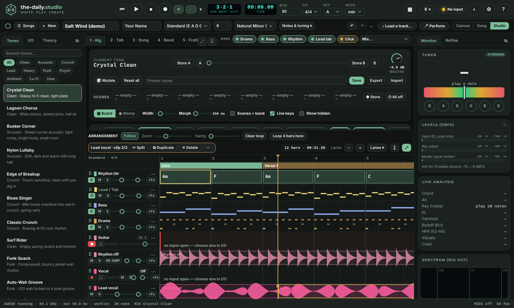

| To do this | Do this |
| --- | --- |
| **Move** a clip | Drag its body. It jumps by whole beats; hold <kbd>Alt</kbd> for no snapping. Nudge from the keyboard with ← → (<kbd>Shift</kbd> = a bar) while the arrangement has focus, or with the arrows in the clip menu. |
| **Trim** it | Drag its left or right edge. The audio is not changed; **Reset trim** in the clip menu brings it all back. |
| **Fade** it | Drag the small square at the top-left or top-right corner, or set **Fade in / Fade out** in the clip menu. The fade is shown as a ramp on the waveform. |
| **Split** it | Put the playhead where you want the cut and press **✂ Split** (<kbd>Ctrl/⌘</kbd>+<kbd>E</kbd>). Both halves share one recording in memory, so nothing is copied. |
| **Duplicate** it | **⧉ Duplicate** (<kbd>Ctrl/⌘</kbd>+<kbd>D</kbd>) puts a copy right after the clip. |
| **Delete** it | **✕ Delete** or <kbd>Del</kbd>. Undo brings it back with its audio. |
| **Save** a clip | Right-click ▸ **Save clip (WAV)**. |

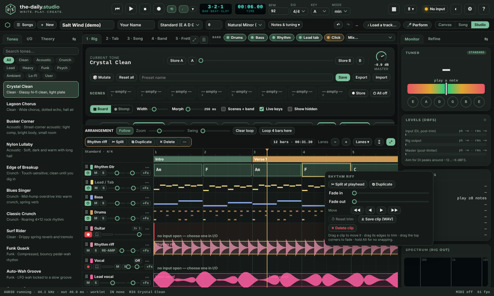

* A lane keeps **one** level, pan, mute, solo and effects strip however many clips it holds. Delete the first clip and the lane's settings pass to the next.
* **Auto-balance** and **Bounce** use the lane as it plays: trimmed parts are silent, fades are applied.
* On a phone the clip bar has a row of its own above the arrangement; the same actions are there, with **⋯** for the rest.
* A clip stays on its own lane. Dragging a clip to a different lane is not built yet.
* **One history.** <kbd>Ctrl/⌘</kbd>+<kbd>Z</kbd> steps back through clip edits, song edits, the stem mix and Auto-balance together, newest first.

### Voice: pitch ribbon, your range, Find my key (2.3)

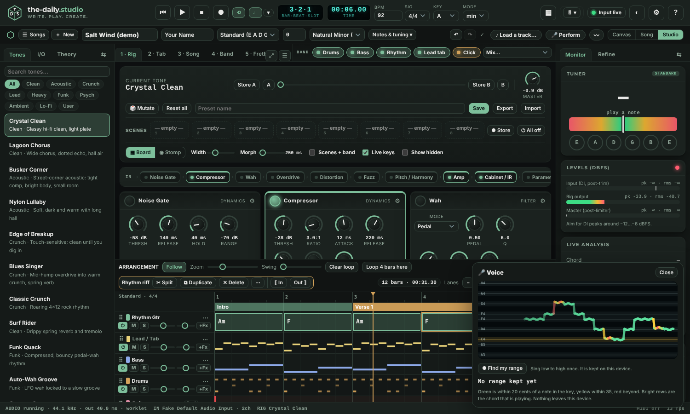

Press the **〰 Voice** chip in the song bar (next to Perform). With an input connected (the Vocal channel, or the guitar input if that is where the microphone is) the window draws the **pitch ribbon**: the note you are singing, over the last few seconds, against the notes of the song's key. Green is within 20 cents of a note in the key, yellow within 35, red beyond. The brighter rows are the chord that is playing.

* **Find my range.** Press it, sing from your lowest note to your highest once, then **Done**. The range is kept on this device only.
* **Find my key.** It compares your range with the song's melody (the lead tab) and suggests the key that sits best in your voice, plus two alternatives, each with how many semitones it moves. **Move the song to …** changes the key, every chord, the `[chords]` in the lyrics and the tab frets together, as one undo step. Recorded takes stay as they were (they are audio). If the song already fits, it says so and changes nothing.
* The ribbon can also sit over the Visuals: the **Pitch** button in the Visuals bar.
* Nothing is recorded by the Voice window and nothing leaves the device. The kill switch (<kbd>Ctrl/⌘</kbd>+<kbd>.</kbd>) stops it.

### Cut, silence and punch in (2.3)

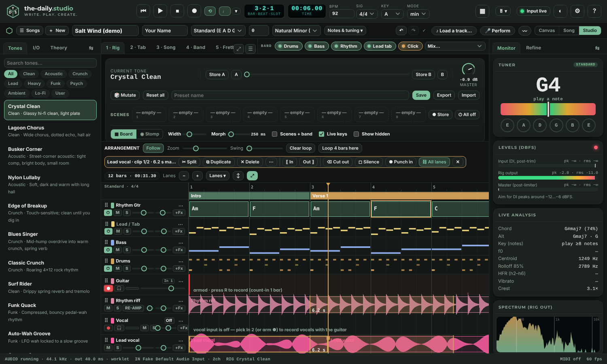

Mark a stretch of a take: **Shift-drag** across its lane (hold <kbd>Alt</kbd> for no snapping), or put the playhead down and press **[ In** and **Out ]** in the clip bar, which also works with a finger. The clip bar then shows its length and the actions:

| Button | What it does |
| --- | --- |
| **Cut out** (<kbd>Del</kbd>) | Takes the stretch out of the recording and **closes the gap**; everything after it moves earlier. |
| **Silence** | Takes it out and **leaves the gap**. |
| **Punch in** | Plays from a bar before the stretch, records **only inside it**, and puts the new audio in the same lane where the old stretch was. |
| **All lanes** | On (the default): every take lane is edited together, so a guitar and a vocal recorded as one pass stay in step. Off: only the lane you marked. |

The band and the chords do not move. Every cut has an 8 ms fade, so it never clicks. Each action is one undo step. <kbd>Esc</kbd> or a click on empty lane clears the mark. **Clip level** in the clip bar and the clip menu sets one clip's level, on top of the lane's own.

### Faster-than-real-time WAV render (2.2)

**Bounce master WAV** and **Bounce this part** no longer wait for the song to play. The app builds a second copy of its sound engine that is not connected to your speakers, schedules every note, take and backing-track stem on it, and mixes the song as fast as your processor allows: the same strips, effects, master tone and limiter that you hear, in the same order.

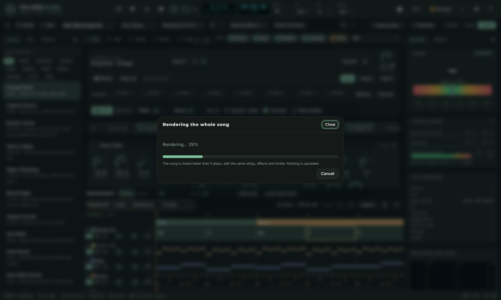

* A window shows progress and a **Cancel** button. <kbd>Ctrl/⌘</kbd>+<kbd>.</kbd> stops it too. While it runs, the sound engine you were using is set aside and put back when it ends.
* The saved file is identical in level and tone to a real-time bounce. The window ends with the render time.
* If the browser cannot do it, a message says so and the bounce runs in real time as before. **Compressed audio**, the **share page** and **Record the stage** still record while the song plays, and say so on their buttons.
* **Settings ▸ Export ▸ Render WAVs faster than real time** turns the fast path off (for example, to compare the two files).
* Speed depends on your device: on a small two-core test server it ran about three times faster than real time.

### Open a MIDI file (2.2)

Drop a `.mid`, `.midi` or `.kar` (karaoke) file on the page, or choose one in **＋ New ▸ Start from a song**, or **⋯ More ▸ Open a file** on a phone.

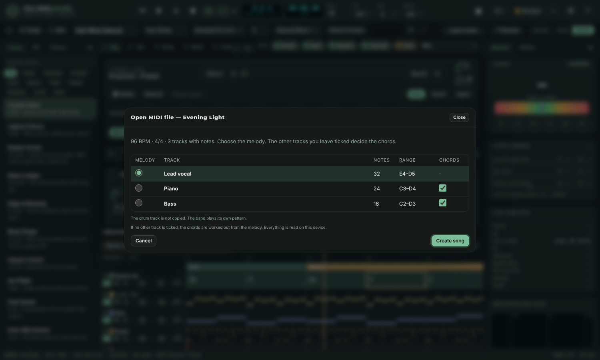

1. **The window** lists the pitched tracks with their note counts and range, and shows the file's tempo and time signature. The track most likely to be the melody is chosen for you; change it with the round buttons. The other tracks are ticked to decide the **chords**. Untick any you do not want. Drum tracks are not copied: the band plays its own pattern.
2. **Create song** makes a new song (your current song is saved first): tempo and time signature from the file; the key worked out from the notes (the file's own key signature is used when it is one of the best fits); chords for every half bar from the notes that sound together, with the lowest note counted most; the melody on the lead tab; karaoke words as lyrics under the chords; and a band style chosen from the tempo and key (Ballad, Folk, Pop, Rock or Dance). With only a melody, chords are suggested from the melody.
3. The song is limited to 160 bars. Very large files (more than 8 MB, 300,000 notes or 128 tracks) and files with SMPTE time are explained instead of opened.

Everything is read on your device. The result is an ordinary song: edit the chords, change the style, add lyrics, record over it.

### Keep songs safe (2.2)

Your songs live in your browser. Chrome and Edge keep them unless you clear site data. **Safari on an iPhone, iPad or Mac clears a website's saved data after about a week without a visit**, unless the site has been added to the Home Screen (or the Dock on a Mac).

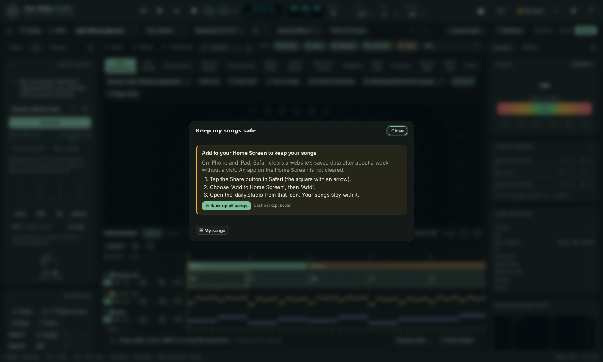

* **⋯ More ▸ Keep songs safe** (and the card at the top of **My songs**) explains it in three steps (Share ▸ Add to Home Screen ▸ Add), and has one **Back up all songs** button that saves every song and recording as one zip. **Open a file** brings that zip back.
* The first time you record a take in Safari on an iPhone or iPad, a one-time tip offers the same.
* A backup reminder appears after a while away: 7 days where the risk is high (Safari not on the Home Screen), 30 days elsewhere. It only reminds; nothing is uploaded.
* On a computer, **Settings ▸ Export ▸ Backup folder** (Chrome and Edge) writes each song to a folder as you work.

### Recording guitar and vocals together

A two-input interface (a Focusrite Scarlett Solo / 2i2 / 4i4, for example) shows up in the browser as **one device with two channels**. The app reads input 1 and input 2 separately, so:

1. Plug the guitar into one input and the microphone into the other.
2. In **I/O → Audio input**, choose the interface itself (not "Default"); in **Channels** set one input to **Guitar** and the other to **Vocal**. A **Focusrite** starts as **Vocal on input 1** (the mic / XLR) and **Guitar on input 2** (the Inst jack); change either and your choice is kept. **Detect & visualise** chooses what the note detector, tuner, neck and visuals follow: **Guitar**, **Vocal** (the neck shows the note you sing) or **Both**; the visuals Source menu can also listen to the vocal microphone directly. The Vocal lane appears with its own meter.
3. Arm both lanes with ● (guitar and vocal), then press <kbd>R</kbd>. You get two takes, aligned to each other and to the band. If only one input has anything on it (a microphone in input 1 and nothing in input 2, say), only that one is kept and a message says the other was silent. To record one lane only, click the ● of the other to turn it off.
4. **Hear myself** monitors both the guitar and the microphone; **Hear vocal** turns the microphone alone on or off; use headphones (or your interface's Direct Monitor with the app's monitor off) or the microphone will feed back. **Vocal polish** adds a 90 Hz high-pass and gentle compression.

Browsers cannot reach more than the channels the operating system exposes for that device. A mono device (a webcam microphone, an input that only exposes one channel) cannot be split into guitar and vocal, and the-daily.studio says so when it detects that.

## Tab editor

* Click a cell and **type a fret number** (0–24). Arrow keys move; <kbd>Del</kbd> clears; <kbd>Shift</kbd>+arrows select; <kbd>Alt</kbd>+<kbd>↑</kbd>/<kbd>↓</kbd> transposes.
* Techniques: <kbd>h</kbd> hammer-on · <kbd>p</kbd> pull-off · <kbd>/</kbd> <kbd>\</kbd> slides · <kbd>b</kbd> bend · <kbd>~</kbd> vibrato · <kbd>x</kbd> dead / muted note · the <kbd>&lt;n&gt;</kbd> button marks a natural harmonic.
* <kbd>Space</kbd> plays from the current bar. **+ Bar / − Bar**, **Copy / Paste / Clear bar**, **Fill bar** and **Fill section** speed things up. **Capture from playing** writes notes you play into the grid while the band runs.
* The picker at the top chooses which section you are editing; the pattern menu next to **Fill bar** / **Fill section** offers fingerstyle and strumming patterns (for example *Fingerstyle pop*) to fill from.
* Bar labels and the string names follow your tuning, e.g. `C# G# C# F# A# D#`.

## Song, tunings and capo

The **song strip** under the header holds the **title**, **artist**, **Tuning**, **Capo** and **scale**, and is visible whatever panel you are in. **Notes & tuning ▾** opens the notes field (they appear in export headers) and the custom per-string tuning editor. The **Song** panel (3) is the map of sections and the **chord library** with several playable voicings for every chord in the current tuning; the lyric and chord canvas for each section is **Refine** (right sidebar).

**Loading a track fills in the song.** When a backing track finishes loading, the strip takes its title and artist (from the file's tags, or a cleaned-up file name such as "Good Morning" from `01 - Good_Morning (Official Audio).m4a`), and sets tempo, time signature, key and scale. If the song has no work of your own yet, the detected chords are written into it. Anything you had is snapshotted first (undo, or **History**, gets it back). The **♪ track chip** at the right of the strip offers *Import chords*, *Use tempo + key*, *Play band with track*, *Open Stems* and *Unload*, the switch **Track follows the transport** and the **When a track loads** setting (fill details + chords, details only, or nothing).

**Pasting finished lyrics.** In Refine press **📋 Paste lyrics** (or paste a whole lyric sheet into any lyric box, or drop a .txt / .lrc file on the panel). Headings like `[Verse 1]`, `[Pre-Chorus]`, `(Chorus)`, `Verse 2:` or `## Bridge` become sections; with no headings, blank-line stanzas become Verses, and a stanza that repeats becomes the Chorus. Choose where it goes (a section per block, fill the sections you have, or add after), how many bars a line gets for new sections, and whether to place your chords over the words. The preview lists exactly what happens, including any sections that would be replaced. One undo puts everything back.

**Loading a chord sheet.** A song's chords and words, the way tab sites and songbooks write them, become a whole song. Open **☰ Songs ▸ 🎸 Paste a chord sheet…** (or **🎸 Paste chords** in the Songwriter workspace, **📋 Paste lyrics** in Refine, paste it into any lyric box, or drop a .txt file) and paste:

```
[Verse 1]
Am            F
Late night, city lights
C                 G
Right here with you
```

The import box sees the chords and switches to *Import a chord sheet*. It reads:
- **a line of chords over a line of words**: each chord keeps its place over the syllable it was over;
- **inline chords** (`[Am]Late night, [F]city lights`) and **ChordPro** (`{title: …}`, `{key: …}`, `{tempo: …}`, `{c: Chorus}`, `{soc}` … `{eoc}`);
- **chord-only lines** for intros and solos, with `|` bar lines (`| Am | F | C G |`) and repeats (`x2`);
- **headings** (`[Verse 1]`, `(Chorus)`, `Bridge:`) as sections, and **`Capo: 2`, `Key: E`, `Tempo: 96`** and a **`Title - Artist`** line at the top.

Before you load it, the preview shows the sections, their bars and every chord, and the key it found. You choose:
- **Where it goes**: a new song (the default; the song you were on stays in ☰ Songs), replace this song's sections, or add after them;
- **Each chord lasts**: 1 bar, 2 bars, or half a bar (two chords of a line to a bar);
- **Key**: read from the chords (or from `Key:`), or one you pick;
- **Guitar part in the tab**: a strum or picking pattern written from the chords, or none.

After loading, the band (drums, bass, rhythm guitar) plays the chords: press Space. While it plays, the stage's lyric line and 🎤 Perform show the line being sung with its chords above the words, where the sheet had them, the chord being played lit; each line comes up when its chords do. **Write** opens with the tab and the words with their chords, **Theory** shows the key, the **Fretboard** follows each chord, and **🎤 Perform** shows the chords and words full screen. With no title in the sheet, the first line of the chorus is offered as the title. A chord the app cannot play is played as the nearest simpler one (*Cadd11* as C, *A7sus2* as A7) and the preview lists them. ASCII tab in the sheet (`e|--0--3--|`) is left out; the tab is written from the chords.

**AI agents can use the studio.** If your browser has an AI assistant that supports WebMCP (or you run an agent that drives web pages), it can use the studio's tools instead of clicking around: *get_song*, *get_studio_state*, *get_key_chords*, *load_chord_sheet*, *set_song_details*, *transpose_song*, *edit_section*, *add_section*, *remove_section*, *set_band*, *transport* (play, stop, loop, click; never record), *open_workspace*, *list_songs*, *open_song*, *export_song* and *undo*. Ask it, for example, “load these chords and play it in G”, “write a bridge in the key of the song” or “give me the ChordPro”. Each change shows a 🤖 note and is one undo step. The tools run in the page; they cannot use the microphone, the camera, recording, deleting songs or Settings. **Settings ▸ Workflow ▸ Let AI agents in this browser use the studio** turns them off. Agents that run scripts find the same tools at `window.dailyStudio` (`dailyStudio.tools()`, `dailyStudio.call(name, input)`).

**Refine** is the shared space for lyrics and chords: each section is a card with its name, bars, lyric lines and chord names. Keep any other panel (Tab, Fretboard, Stems, Transcribe) open in the centre while you write.

**Tunings.** Choose a preset (Standard, Eb, D, C#, C, B; Drop D, Drop C#, Drop C, Drop B, Drop Bb, Drop A, Double Drop D; DADGAD; All fourths; Open G, D, Dm, E, C, A; slack-key tunings), or open **Custom tuning · set each string** to pick the note and octave of all six strings (E1–G5). Quick shifts: **↓ ½ step**, **↑ ½ step**, **Drop low string**, **Reset to standard**. The **Theory** tab in the left sidebar has the same tuning menu, and the strip's **Tuning** menu is the quickest way to change it.

Everything follows: the tuner's string circles (click one to hear its reference tone), tab and fretboard labels, chord voicings, tab playback, live note and chord detection, transcription, and exports. Flat tunings are spelled with flats.

**Capo** (0–12) raises every open string; voicings, the fretboard and detection take it into account.

## Fretboard and tuner

The **Fretboard** (5) draws a hexagon fretboard for your tuning and capo. Pick a **Root** and a **Scale** (major, minor, pentatonics, blues, the modes, harmonic and melodic minor, Phrygian dominant, whole tone, diminished, Hirajoshi), then choose what to overlay: **Scale**, **Chord tones (current chord)**, **Scale + chord**, or **Live only** (just what you play). Label notes as **Note names**, **Scale degrees** or **Fret numbers**; **Follow song** tracks the song's key and chord; **⇄ Handedness** mirrors the board for left-handed players. Click any note to hear it. With Vision active, tracked finger positions overlay too.

### Heatmap (2.3)

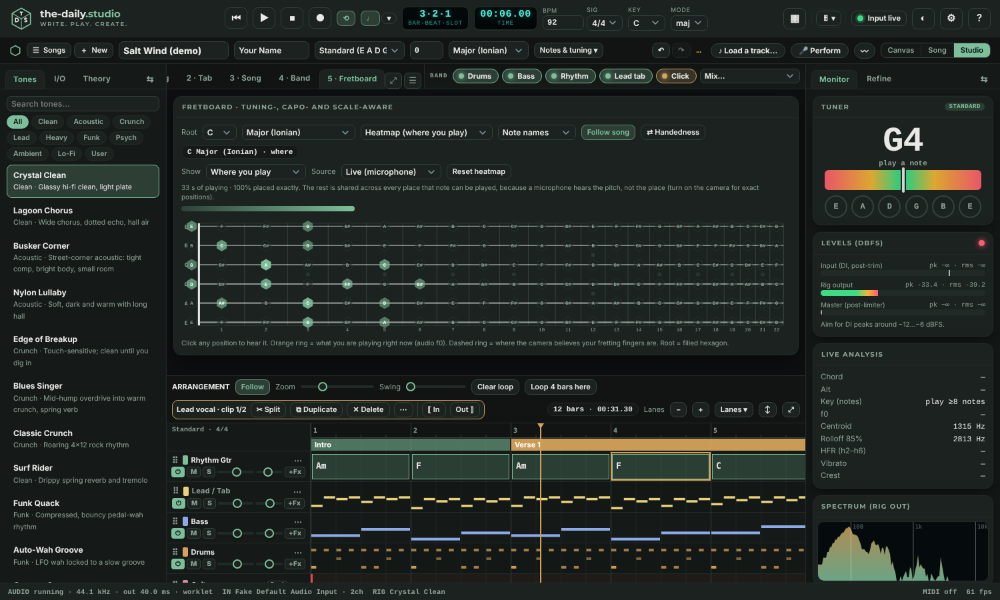

Choose **Heatmap (where you play)** in the third menu of the Fretboard. Three views:

* **Where you play**: time spent on each string and fret. Brighter is more.
* **How in tune**: the average cents at each position. Blue is flat, green is within 7 cents, orange is sharp, grey was played too briefly to measure.
* **Which notes belong**: every position coloured by the key and the chord under the playhead (chord tones in the accent colour, key notes in the second colour, notes outside the key in red), sized by how much you used it, with the share of your playing that is inside the key.

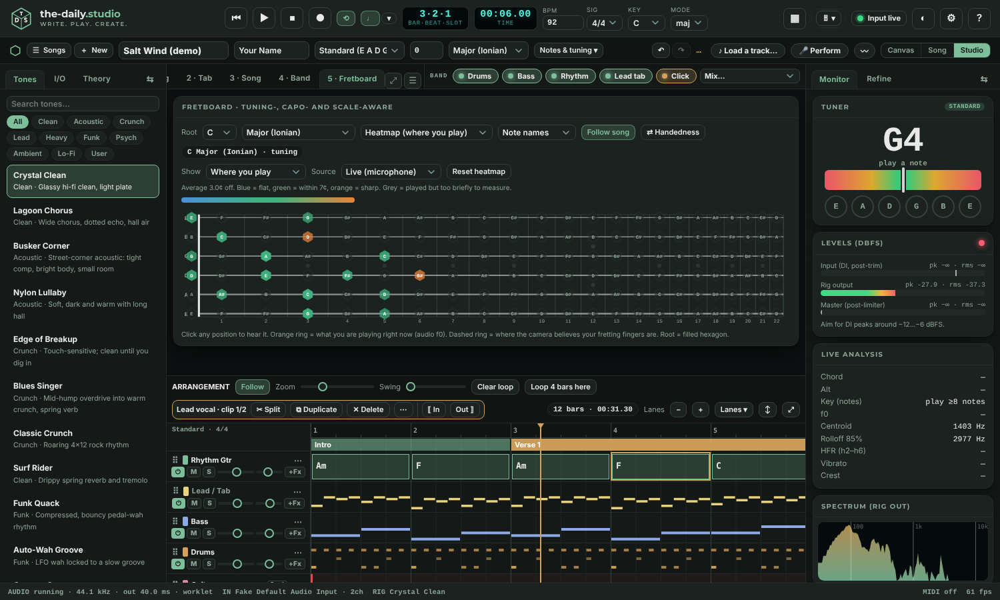

**Source** is **Live (microphone)**, kept for the session and across reloads on this device, or **Song (tab + chords)**, which counts the lead tab and the chord shapes. **Reset heatmap** clears the live one; changing the tuning or capo starts a fresh one, because the old frets would be wrong.

**An honest limit.** A microphone hears a pitch, not a string. The same note can be played in several places on the neck, so live time is placed **exactly** only when the camera sees your hand (Vision tab) or the note has one possible place. Otherwise it is shared evenly across every place that note can be played, and the summary line says how much of your playing was shared. For exact positions, turn the camera on, or use the **Song** source, which is written down and so is exact.

The **Tuner** (right sidebar) shows the detected note, frequency, cents and clarity. A note within ±5 ¢ turns green. Click a string circle for a reference pitch. Below it are the level meters, **Live analysis** (chord, key, centroid, rolloff, vibrato and more) and a spectrum.

## Transcribe: audio to tab

Turns a recording into polyphonic tab for your tuning.

1. **Source.** Pick a take, **Import audio…** (WAV, MP3, etc.) or **Record & transcribe**.
2. Adjust **Sensitivity**, **Max simultaneous notes**, **Quantise to** (16th / 8th / quarter), **Auto-align timing**, and whether to detect **bends & vibrato** and **hammer-ons / pull-offs / slides**. Under **Musical priors**, *Chord-shape repair* tests the bar's chord voicings against the spectrum and keeps the one that explains the audio best (it recovers octave-doubled strings), sliders set how strongly chord shapes and the camera log influence string / fret choices, and *Hide notes below confidence* filters the display.
3. **Review.** Notes are placed on strings and frets and coloured by confidence. Hover for details; click to accept or reject; rejected notes are ignored on apply. A timing plot shows each event's error against the grid.
4. **Apply to song** with **Replace bars** or **Merge into empty slots**; optionally name empty bars' chords from what was heard. **Copy tab** and **Export report (JSON)** are also available.

Quality tools:

* **Run self-test** transcribes synthetic Karplus-Strong guitar with known ground truth in *your current tuning, capo and settings* and reports precision, recall, F1 and string/fret accuracy. Synthetic audio is cleaner than a room, so treat it as an upper bound.
* **① Measure noise** (3 s of silence) sets a note gate for the tuner, detection and visuals. **② Check open strings** walks you through the open strings and flags tuning, level and clipping problems, then stores your guitar's brightness and sustain.

Tips: record a clean, dry take; avoid heavy distortion for transcription; play chords in a steady rhythm; use two takes of the same part to unlock *consensus* transcription that drops random ghost notes.

## Stems and backing tracks

Load a backing track to separate it, learn its structure and play along.

1. **Load backing track** (any audio file your browser can decode). Analysis runs locally in a worker with a progress bar.
2. The waveform shows the mix and four stems: **Drums**, **Bass**, **Vocals** and **Guitar · keys · other**, with the detected chords above. Click a lane to seek, **Shift-click** to set a loop start, **Alt-click** to set a loop end. Each stem has **M**ute, **S**olo, a level and a **⤓ WAV** export, plus a presence estimate (for example "strong · 76 % of track · enters 0:09").
3. **JAM** presets set the mix in one click: *All*, *Play the guitar* (mutes the guitar / keys stem), *Play the bass*, *Karaoke* (mutes the vocal) and *Drummer's out*.
4. **Tempo · key · chords · groove** reports the tempo, key, how many bars it found and the drum groove it averaged. If it found double- or half-time, use **½ tempo** / **2× tempo**; if the bar lines are off by a beat, use **‹ downbeat** / **downbeat ›**; **reset** returns to the automatic result. Each detected bar's chord is listed (hover for its time).
5. The track and each stem also appear as **lanes in the arrangement**, aligned to the bar grid, with their own mute, solo and level. With **Track follows the transport** on (the default), play, stop, seek and loop in the main transport move the track with the band.
6. Use the result: **Import chords as the song** (a snapshot is saved first), **Use tempo + key only**, **Copy drum groove to the band**, or **▶ Track + band together** to import the tempo, start the track at bar 1 and let the band play with it.

Be realistic: this is classical signal processing (harmonic / percussive separation, a bass harmonic comb, a centre-channel vocal mask) tuned for practice, not studio-grade source separation. Drums and vocals separate best; the guitar / other stem is whatever is left, and the app cannot tell whether a guitar is present at all.

### Sample tracks

Under the *Load backing track* button, **Sample tracks** lists any songs the site owner has bundled (none ship with the app). Tap one to load it into Stems; **Transcribe** has the same shelf under *Import audio*. The file is fetched from the site only when you tap it, so a 5 MB track costs nothing until used. The shelf is hidden when the page is opened straight from disk, in CodePen, or from a single emailed `index.html`, because those have no `samples/` folder beside them.

**Add your own (repo owners):** copy the audio into `samples/`, optionally name it in `samples/info.json`, run `npm run build`, commit and push. Only add music you have the right to share: a public repository is public.

## Neural map

A node graph of the music as it plays: notes, chords, functions (tonic, subdominant, dominant), sections and the key form layers, with learned transitions between chords shown as edges. Switch between **Layers**, **Fifths** and **Force** layouts; colour by pitch class, time in song, section, loudness, octave or chord quality; toggle edges, learned transitions, notes, the path taken, labels, unheard (not yet played) nodes, the floor, pulses and spin; scrub the **Replay**; **Pre-train** the transition model from your song or **Forget** it. Hover or click nodes for details; drag to rotate, right-drag or Shift-drag to pan, wheel to zoom, double-click to reset the view.

## Visuals and Stage

**Visuals** (6) offers **Hex Resonance** (the default; the **Hexagons** swatches pick the colours: *Match the theme* (the default), Dark green, White, Ocean, Ember, Violet, Mono, Blush, Daylight, or *Pick your own* for a background, cell and gold-cell colour; the start screen uses the same choice), **Concert**, Chord Bloom, Harmonic Orrery, Beat Grid, a Prompter, the Neural map, **Fifths Halo** (the circle of fifths as a ring around you, with the song's chords on it and your notes flying in) and **Prism** (a kaleidoscope that changes on the off-beat; its flashes and spin follow Light comfort). In full-screen, **✦ Look** cycles Hex Resonance, Concert, Fifths Halo and Prism. The pitch wheel, spectrogram and scope are readouts rather than shows, so they are on **Monitor ▸ Views** (and are still Stage scenes). **🎸 Neck** puts a small guitar neck on the visuals and the Neural map: what is playing, a dashed ghost of the note coming next, the note you are singing (pink, at every place it can be played) and any chord you click in the Neural map, driven by the rig output, the master mix or your dry DI. Add a **camera backdrop** or go **⛶ Stage mode**.

**Behind you (2.12).** A second row in the Visuals bar holds six backdrops made to sit behind you: **Light Ribbons**, **Aurora**, **Warp Stars**, **Pulse Rings**, **Nebula** and **Skyline**. Choose one, then set **Camera look** to *Me in front (green screen)* and you stand inside the picture (the first time you need an internet connection to fetch the small segmentation model; see Privacy). The colour follows the chord and glides when it changes; the movement follows the sound; **Light comfort ▸ Calm** slows it to about half. Nothing flashes. They also work full screen, in the stage designer and in recordings.

**Camera look.** Turn on **📷 Camera backdrop** (Visuals tab, or per scene in Stage) after starting the camera in the Vision tab, then pick how it sits with the visuals: *Dimmed behind the visuals*; *Visuals frame me (edges in)*, where you stay clear in a soft oval and the visuals live around the edges (drag the slider to size the clear area); or *Me in front (green screen)*, which cuts you out so the visuals play behind you. The cut-out downloads a small model the first time (Google's selfie segmenter, nothing is uploaded); offline it falls back to edges-in. Good light and a plain-ish background help the cut-out.

**Stage** (7) is the performance surface: full-screen visuals with **eight scenes** (<kbd>1</kbd>…<kbd>8</kbd> when Stage is focused, or MIDI notes 48–55). The first six are the six looks (Theatre, Backlight, Blades, Pixel field, Horizon, Laser room), then a lyric prompter and you in front. Each scene picks a visual and sets hue and hue drift, trails, glow, kaleidoscope, sensitivity and beat flash, plus overlays for the current chord, lyric, beat, tuner and song info. **Auto-switch on section** changes scene by section name as the song plays. Move the mouse to show the controls; they fade when idle.

### Harmony looks (2.10)

Ten looks that draw what the chord is doing. Each works out, from the chord that is sounding (the song's while it plays, otherwise the one heard, otherwise the key's), which notes are **chord notes** (gold), **colours** (teal) and **tension** (red), and shows your note against that. Tension is a simple measure, distance from the chord's own notes with a small penalty outside the key, so a red note means *use it, then resolve it*, not *wrong*.

| Look | What you see | What to try |
| --- | --- | --- |
| **Harmonic Gravity** | The chord as a sun; notes orbit near, far or out in red. | Sing a note a half-step above a chord note and watch it pulled out; let it fall onto a chord note. |
| **Improv Field** | A map of the twelve notes: safe, character, tension, with your trail. | Play a line and look for where it rests. |
| **Voice & Guitar** | Two swarms that attract when they agree and push apart when they clash. | Needs two inputs (Inputs ▸ a voice input and a guitar input). With one, the line you sing or play is the voice. |
| **Mood Colour** | Warm gold for major, blue for minor, a bloom when tension resolves, lightning on tense dominant moments. | Lightning follows **Light comfort**; **Calm** has none, and it never comes more often than the gap allows. |
| **Chord DNA** | Each chord a flower; its notes decide petals and symmetry. | Play four different chords and compare the row. |
| **Constellation** | A star for each steady sung note: flat to the left, sharp to the right, brighter in tune. | Hold a note; the star lands where you were. **New session** and **Save picture** are on the screen. |
| **Rhythm Flow** | Ripples for each note, placed by where it falls in the bar; calm streamlines when the groove is steady. | Run the band (or click), then play on the beat and then rush it. |
| **Session Painting** | The session as a painting: height is pitch, colour is harmony, speckle is timing, stroke weight is how hard you played. | **Save picture** writes a 1920 × 1080 PNG. |

The Constellation and Painting keep a record of the session in memory only. **↺ New session** clears it; closing the page clears it too.

### Show setup (2.6)

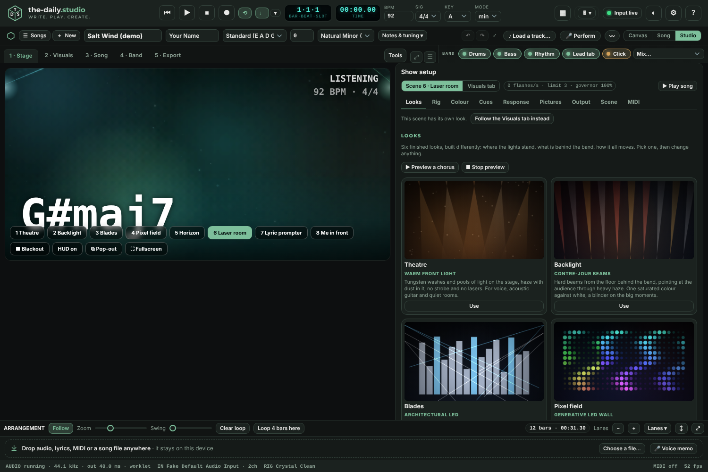

The console is for the person who sets up the show in a room: a stage manager, a lighting or video technician, or a band doing its own. It lives in the **Stage** tab, under the picture it changes (beside it when the pane is wide), so every change is seen as it is made. **🎛 Show setup** in the Visuals bar opens it too. The buttons at its top say what it is changing: the **Stage scene** on the screen, or the **Visuals tab**'s look.

Your changes are kept as differences from the look you started from, so **Reset** always has somewhere to go back to. Nothing about a show is stored in a song.

**Looks.** Six finished looks, built differently (where the lights stand, what is behind the band, how it all moves), not six colourings of one rig. On the Visuals tab, **Match the look to the song** picks one from the song's feel (kit, groove, key and tempo) until you choose one yourself.

| Look | What it is |
| --- | --- |
| **Theatre** | Warm front light: tungsten washes and pools of light, haze with dust in it. No strobe, no lasers. Voice, acoustic guitar, quiet rooms |
| **Backlight** | Contre-jour: hard beams from the floor behind the band through heavy haze, one saturated colour against white, a blinder on the big moments |
| **Blades** | Architectural LED: tall hard-edged bars across the stage that rise and fall with the spectrum, cool white and steel, a few precise lasers |
| **Pixel field** | A generative LED wall: the spectrum climbs it, every note ripples out from a point, the kick pulses its centre |
| **Horizon** | Cinematic: a low sun on a long horizon with rays over the haze that rises into the chorus and sinks in the outro |
| **Laser room** | A black room with thick haze, side towers and lasers, with a different laser kit for every section |

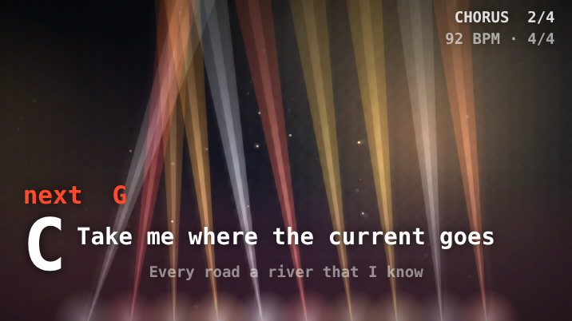

**Your looks.** Name the look as it is now, with all your changes (not your pictures), and bring it back on any scene. Up to 24. **Save all as a file** and **Open a looks file** carry them to another device; a file is checked on the way in, and anything that is not a known setting is dropped.

**Rig.** Where the moving lights stand (a truss over the stage, the floor behind the band, towers at the sides, a wash, or none), how many, beam style and spread, floor lights, the room (quiet or sky and horizon), drifting colour fields, haze, dust and embers, what is behind the band (nothing, spectrum columns, blades, a pixel field, a horizon and sun, or your own picture as a pixel wall), laser amount and the starburst on the drop, overall brightness, the blinder, confetti, how long one sweep takes and whether movement steps on the beat.

**Colour.** Six colours (the room, three lights, two lasers), a colour treatment (full colour, two colours or one colour, for a disciplined stage) and the palettes of the other looks to borrow.

**Cues.** A cue sheet for each kind of section (intro, verse, pre-chorus, chorus, bridge, solo, outro; a section takes its kind from its name). For each: the level, how many lights are on, haze, floor lights, the backdrop, whether it starts with confetti or a blinder, which light patterns the moving lights take (several move on every four bars) and which laser patterns run. **Preview** plays a silent band for that kind of section, so a cue can be set and rehearsed without a song; tick **As the last time through** to see the biggest version.

**Response.** How strongly the kick, snare, hi-hat, bass notes, guitar strums and lead notes drive the lights, from nothing to 150 %. A live meter beside each shows what is arriving now, and **Fire** sends one hit so you can see what it does.

**Pictures.** Your own pictures (below).

**Output.** What goes to the screen, the full-screen view and the pop-out window:

* **Master level**, **blackout** (<kbd>0</kbd> while the Stage is showing; it fades) and **freeze** (<kbd>9</kbd>; the picture is held for the output while the lights go on behind it).
* **Mirror** left to right (a projector behind the screen) and **flip** upside down (a projector hung from the ceiling).
* **Safe-frame guides** at 90 % and 80 % on this screen (not drawn on the output).
* **Test patterns**: bars, grid (with a circle, diagonals and the pixel size), ramp, grey, white and black, to line up a projector and check colours. White is very bright.
* **Frame rate** of 60 or 30 a second, render quality, and **Light comfort**.
* A **flash meter**: flashes per second against the limit of three, the governor, and the highest this session.

**Scene** holds the Stage scene's own settings (the name, hue, trails, glow, kaleidoscope, sensitivity, beat flash, overlays and switching by section name) and **MIDI** is the MIDI output for lights, synths and a DAW. **Restore starter scenes** puts the eight scenes back as they shipped. If you changed any of the old scenes, they were left as they were.

The show is a picture on a screen. Nothing here sends DMX, ILDA or any lighting-control signal, and a MIDI note does not trigger blackout yet.

**Why it moves the way it does.** Everything follows one clock: where the song is, in bars. Beams and sweeps are locked to the bar (a four-bar sweep is back where it started four bars later), the band's drum hits, bass notes, chords and lead notes light the rig at the moment they sound, and each section calls for a combination of lasers that changes on four-bar phrases. It is never a timer on a loop. With no song playing, your own notes move the show.

**Lasers.** Eight patterns (fan, cone, zipper, curtain, lattice, scribble, tunnel, and a starburst on the drop) are drawn on the screen and brighten on real kicks, snares, strums and lead notes. They are a picture; nothing here controls laser hardware.

#### Your own pictures

Drop a band photo, a poster, a logo or a venue into the **Pictures** tab, then say what each is for: **Back** (behind the lights; several pictures change at each new section), **Wall** (shown as a pixel wall that the music plays across) or **Logo** (lit by the band; choose its size and corner). Pictures are reduced to 1920 px and kept in this browser only. They are never uploaded, they are not part of a song's `.zip` or a backup, and clearing the site's data removes them. JPEG, PNG, WebP and GIF work; SVG is refused. Up to 24. Only use pictures you have the right to show.

#### Light comfort

Choose **Calm**, **Standard** or **Full show** on the Output tab. Calm has no strobe, slower movement and softer pulses, and it is the default if your device asks for reduced motion. Standard has soft pulses on the beat and a gentle flash at the top of a chorus. Full show is the whole production at full strength.

In every setting the show keeps to **no more than three flashes in any second**: the blinder fires at most once a bar and never closer than a third of a second (a second in Calm), and the show watches its own picture and eases every pulse and flash back if brightness starts to swing too often. This is a safeguard built into the app, not a medical guarantee; if lights or motion ever bother you, choose Calm or stop the show. On a slow computer the show drops its laser halos and some moving lights until frames are quick again.

### Concert (2.4)

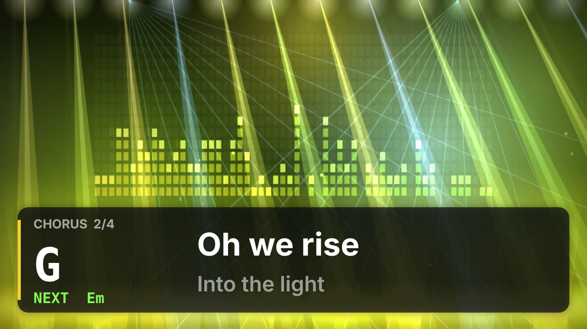

A lighting rig that listens, and the default visual. It is built like a touring show:

* **Colour is the harmony.** Each look has its own palette. As the song moves round the circle of fifths the lights lean towards the palette's other colours, and tension pulls towards its third light, so a modulation is a colour change you can see. (The Teach lens still colours the circle of fifths itself by hue.)
* **Mood you can see.** Loudness and density, major against minor, tension (diminished, augmented and dominant chords, and how far from home you are) and brightness set the saturation, speed, number of beams, haze and glow. It is smoothed, so it moves like a person reading the room.
* **Lights on the band's real drum hits.** Kick pumps the floor lights, snare flicks the beams and fires the blinder, hats step the chase, toms jump it. Because the hits are scheduled on the audio clock, off-beat hats and ghost notes show up exactly where they are played. With the band off, your own playing drives it.
* **A cue list from the song.** A build before a chorus, a drop on it (flash, wide beams, confetti), a cool sparse bridge, tight spots for a solo. Name your sections (Verse, Pre-Chorus, Chorus, Bridge, Solo, Outro) and it follows.
* **Light comfort** (Calm, Standard or Full show; see [below](#light-comfort)) decides how hard the lights hit, and the show never flashes more than three times a second.

Three **lenses** on the same show, in the Visuals bar and in Stage ▸ Performer backdrop:

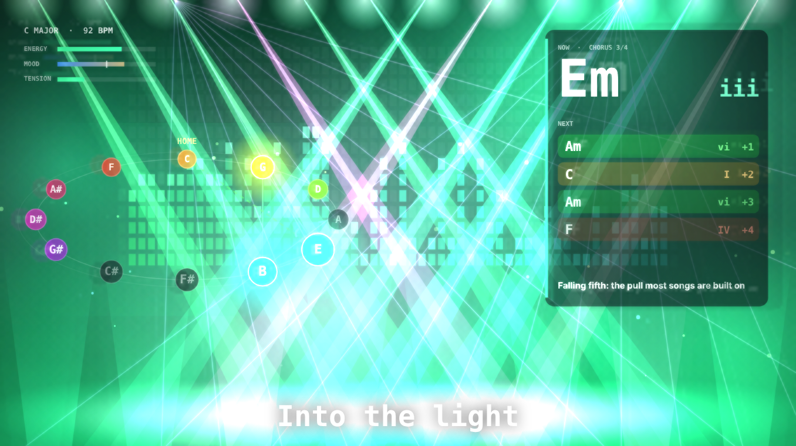

* **Perform**: big and calm, for an audience.
* **Teach**: the circle of fifths as a lit ring (home marked, your key's notes bright, the chord's notes joined, a dashed path to the next chord, and the note you are playing circled), a card with the **roman numeral** of what is playing and of the next four chords, and one line on why the next chord pulls the way it does. Energy, mood and tension are shown as meters.
* **Sky**: every chord you play becomes a star and every move a line; lines that repeat glow brighter. **⤓ Save sky** downloads the session as a PNG poster, **New sky** starts again.

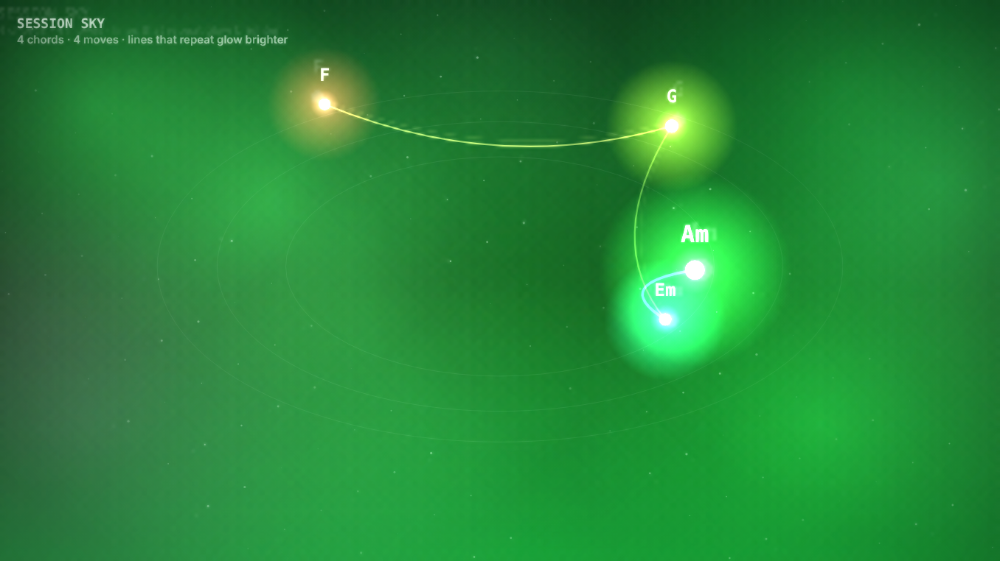

With the performer backdrop's lower third on, Teach and Sky draw in the room above it.

### Audience view (2.11)

A Monitor widget that shows the show the way the room sees it: the visuals with **you in front of them** (from the camera, **not mirrored**, which is the side the audience sees), so you can watch your own expression while you record. Add it from **Widgets** at the top of the Monitor (the Record layout already has it). Its **📷 Camera on** button starts the camera; choose **Me in front (green screen)** in its Camera look menu to stand in front of the show, or **Visuals frame me** for a soft oval. It works while you are on any tab; when the Visuals tab is open it simply copies that picture, which is mirrored if your camera is.

### Speed, size and zoom (2.15)

**🎚 Speed · size · zoom**, in the Visuals bar and the Stage's scene bar, opens three sliders that apply wherever the visuals are drawn (the Visuals tab, the Stage, Perform's backdrop, the Audience view) and are remembered:
- **Speed** (¼× to 3×): how fast every look moves.
- **Size** (½× to 2½×): how big the hexagons are in Hex Resonance and the Stage's pulse grid: fewer, larger tiles, or a fine mesh.
- **Zoom** (1× to 3×): pushes in on the middle of any look, like a camera.

The camera, the chord, the words and the small neck are not changed. **Reset** puts all three back to 1×; double-click a slider to reset just that one.

### Your playing from the video goes into the arrangement (2.11)

When you **⏺ Record the stage** as a video, the menu has **Also put what I play into the arrangement**. With it on (the default once an input is connected), what comes in on your armed guitar and voice inputs becomes a lane in the arrangement, **starting where the video starts**, as if you had pressed Record. The band is not in it (it is already in the arrangement). For *The whole song, from the top*, the lane starts at the song's first beat. **Undo** takes the lane out. The kill switch (<kbd>Ctrl/⌘</kbd>+<kbd>.</kbd>) throws the video and the lane away together. If no lane is armed, the guitar lane is armed for you.

### Monitor widgets (2.6)

The Monitor opens short: the **Tuner** and **Levels**. A row of chips at the top adds the others, and a **✕** on a widget takes it away again: **Analysis** (chord, key, brightness, vibrato, crest), **Spectrum** (the rig output) and **Views** (the pitch wheel, spectrogram and scope, switched with three buttons) and **Audience** (2.11: you and the show as the room sees it). A widget you have removed is not drawn or updated at all, so it costs nothing. Drag a widget by its title to reorder, click the title to collapse it. Each layout brings the widgets that suit it (Record: tuner and levels; Tone: tuner, analysis and spectrum).

### Performer backdrop (2.3)

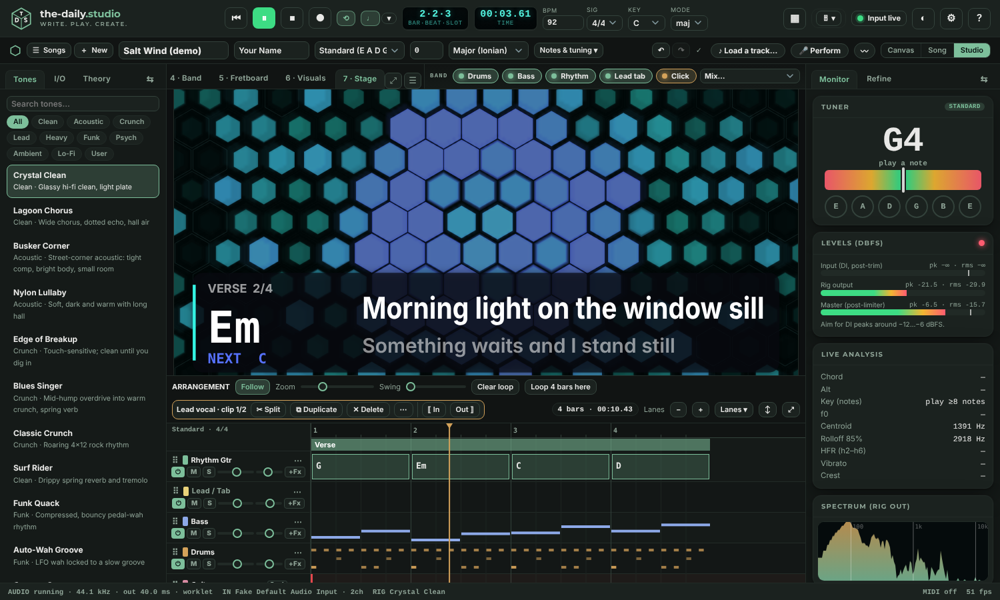

For when people are looking at you and not at the picture. In **Stage ▸ Performer backdrop**:

* **Calm motion** and **Dimming**: long trails, no flashing, a softer glow, and the picture eases to a new colour when the section changes. It still breathes with you: a little brighter when you play loud, darker when you stop.
* **Lower third**: the chord and the next one, the section and bar, and the lyric line with the one after it, in a panel along the bottom (or the top). Three sizes.
* **Background**: the visuals (dimmed), **plain black**, or **chroma-key green**.
* **Clean output window** opens a bare window with only the picture, no buttons, the pointer hides after a moment and the edges match the background. Drag it to the projector and double-click it for full screen. In OBS, add it as a **Window Capture** and use **Filters ▸ Chroma Key** on the green. **Full screen** does the same for this window.

Nothing is sent anywhere: the output window is fed from this page's own canvas. The kill switch still stops everything.

## Vision lab

Uses your webcam to relate what your hand does to what you play.

1. **Camera on/off**, choose **Hand tracking (MediaPipe via CDN)** or **Motion energy only (offline)**.
2. **Calibrate neck**: frame the neck head-on, press ⌖, then click the nut on the low-E string, the 12th-fret marker on the low-E string, and the nut on the high-e string. Fret spacing uses the equal-temperament rule `d(n) = L·(1 − 2^(−n/12))`.
3. Fusion statistics compare camera-estimated fingering with detected notes. Camera frames never leave the page; the hand-tracking model downloads from a CDN only after you choose it and answer yes to the one-time question (see [HOSTING.md](HOSTING.md#8-self-hosting-the-camera-model-files) to self-host it).

## Research panel

Live and session measurements: pitch-class usage and intonation (mean cents deviation per note), timing against the click (mean, standard deviation, 95th percentile), vibrato events, attack harshness (HFR), noise floor and SNR, crest factor, clipping, key estimate, latency and camera agreement. **⏱ Loopback latency test** measures round-trip delay. **CSV** and **Session JSON** export everything for your own analysis.

## Perform, share and back up (2.0)

**Perform.** Press **🎤 Perform** in the song bar (or on the full-screen stage). A readiness check comes first: audio is running, your input is connected (with a live level), the camera if you want it, lyrics to follow, and the count-in length. **Start performing** then shows the chord huge with the next one under it, the lyrics scrolling with the song, a big count-in, and **Play**, **● Record**, **Loop**, **Click** and tempo −/+ within reach. Tick **Show the visuals behind** to put the stage behind the words, or leave it for a plain dark page. <kbd>Space</kbd> plays or stops, <kbd>R</kbd> records, <kbd>Esc</kbd> leaves, and <kbd>Ctrl/⌘</kbd>+<kbd>.</kbd> stops everything. A finished take goes straight into your song.

**Perform's displays.** The **Display** button at the top switches between three looks, and the choice is remembered:
- **◫ Chords & shapes** (the default): the big chord and the lyrics, with a panel beside them showing the shape of the chord being played (NOW) and the next one (NEXT), worked out for the song's tuning and capo (the voicing you picked on the Fretboard, if you picked one), the frets under each (x = not played, 0 = open), and the chords after that. On a phone the panel sits above the lyrics, and the NOW and NEXT cards take the place of the big chord.
- **◼ Big chord**: the big chord with the next one under it, and the lyrics.
- **☰ Lyric sheet**: no big chord; the lyrics larger, with more lines and their chords over the words, like reading from a songbook.

**Version.** The very bottom-right corner of Perform, and the end of the status bar, show the version and build code (for example *v2.15.0 · build 2a3be1d*), so you can tell which build is running. Help ▸ About shows the same version.

**Voice memo.** On a clean canvas, **🎤 Voice memo** records your voice as it is: one Vocal take at the start of the page, no analysis and no band. The page grows enough bars to play all of it.

**Auto look.** **🎬 Auto look** in the Visuals bar makes the look follow the section while the song plays (choruses open into the Fifths Halo, bridges into Prism, intros and outros into the Tunnel). When playback stops, your own look comes back.

**Export and share** (the Export panel, and the Save menu on the hum result):
* **Bounce master WAV** is rendered faster than the song plays (see [above](#faster-than-real-time-wav-render-22)) and reports the song's loudness (LUFS) and true peak. **Settings ▸ Export ▸ Loudness target** can bring song WAVs to −14 (streaming), −16 or −23 LUFS, never past −1 dBTP. Part WAVs are left as they are.
* **Compressed audio** saves M4A (or Opus in a .webm where the browser cannot make M4A). It plays once in real time, like a bounce.
* **Share page** saves **one HTML file** with the sound, lyrics, chords and a small player. Open it in any browser or send it. Click a lyric line to jump there. It loads nothing from anywhere.
* **Print or PDF sheet** makes a clean sheet with chords over the words for the browser's Print dialog (choose **Save as PDF** there).
* **⏺ Record the stage** (Visuals bar) saves a video of the visuals with the song's sound.

**Backup folder** (Chrome and Edge on a computer). **Settings ▸ Export ▸ Backup folder ▸ Choose a folder…** Each song is written there as a `.daily-song.zip` shortly after you change it, and **Save all songs now** writes them all. A folder inside a cloud drive works with that drive's own sync. After a browser restart it may ask once to allow access again. No account is involved: the browser writes the files directly. Renaming a song leaves its old file in the folder.

## Export, history and backup

* **Ultimate Guitar** text with `[ch]` / `[tab]` tags (toggle off for plain text), **ChordPro**, lyrics-only, and tab-only, each with **Copy** and **Download**. A **submission lint** warns about unreadable chords, over-wide lines and similar problems.
* **MIDI**, **Bounce master WAV** (rendered faster than real time), **Each band part (WAVs)**, **All takes (dry DI + wet)**, **Project JSON** (<kbd>Ctrl/⌘</kbd>+<kbd>S</kbd>), **Import project**, **Load demo song**, **New blank song**.
* **Version history** snapshots your song automatically (before each play, periodically and when you leave the page) and keeps the last 30 in this browser. **Restoring** first snapshots the current state, so it is reversible. **＋ Snapshot now** makes one on demand.
* Your song autosaves to this browser. **Back up all songs** (☰ Songs ▸ All songs) is your portable backup of everything; **Project JSON** is one song as plain text. Clearing browser data deletes the autosave.

## MIDI

Connect a controller and allow MIDI access when asked (HTTPS or `localhost`; Chromium browsers). Right-click any knob to **MIDI-learn** a control. Pedals can be bound to MIDI notes in their **⚙** menu, pedalboard scene slots respond to notes 36–43, and Stage scenes to notes 48–55, so a pad controller works as a footswitch bank.

## On a phone or tablet

The app switches layout by itself; **⋯ More ▸ Device layout** (or Settings) forces Phone, Tablet or Desktop.

**Phone, portrait.** Top: tempo, signature, key and the **⋯** button. Below it a row of chips for the panels in the current section. Bottom: the transport (rewind, play, stop, record, loop, click and the bar·beat·slot readout) and the five sections:

| Section | Panels |
|---|---|
| **Play** | Rig (tone, A/B, scenes, pedalboard) · Tones · Tuner · I/O |
| **Write** | Tab · Song (tuning, capo, chords, lyrics) · Band · Fretboard · Theory |
| **See** | Visuals · Stage · Neural · Vision |
| **Stems** | Stems · Transcribe |
| **More** | Research · Export |

The **⋯** button (top right) opens the **More sheet**: **Hum or sing a song**, **Audio · kill switch**, **Light theme**, **Appearance**, **Monitor**, **Screen awake**, **Settings**, **Help**, **Guided tour**, **Save project**, **Share link**, **My songs**, **Open a file** (audio, lyrics, MIDI or a song file), **Master · balance · click** (master preset, Auto-balance, count-in and click level), **Keep songs safe**, **Install app** (when the browser offers it), **Full screen** and **Device layout**.

The **Tracks** button at the right of the chip row cycles the arrangement between a mini strip, a **full-screen tracks view** (no other panel competing; the button then reads **▾ Panel**) and hidden. The band strip (drums, bass, rhythm, lead) sits under the chips in *Play* and *Write*.

**Landscape** puts the sections on a left rail and the transport in the header, which leaves the most room for the Fretboard, Stage and Neural map. The arrangement starts hidden there; bring it back with **Tracks**.

**Write tab on a touch screen.** Tap a cell, then a fret on the keypad. **10s** / **20s** turn the next digit into 10–19 / 20–24. **Auto ▶** advances after each note (turn it off to stack notes on different strings). Arrow keys move the cursor and **▲ ▼** change string; **⌫** clears a note; **h p / \ b ~ x ‹n›** set techniques; **⏵ bar** plays from the current bar. Chord names above each bar are edited in **Song**.

**Record a take.** Open **I/O**, pick the input, put headphones on, then in *Play* press **●**. In-app **Monitor** starts off on touch devices; switch it on from **⋯ More** once you have headphones in. The screen stays awake while you play (switch off in **⋯ More** if you prefer).

**Gestures.** Press and hold a knob or a band chip for its right-click menu. Drag on the Neural map to orbit, pinch to zoom and use two fingers to pan. Open a pedal's **⚙** and use **Earlier / Later** to reorder the chain.

**Stage.** **⛶ Full** in the Stage panel fills the screen; rotate to landscape and prop the phone on a stand.

**Tablet.** The tab bar, band strip and arrangement stay as on desktop. Tap **☰** (top left) for Tones, I/O and Theory and the tuner icon (top right) for the tuner, levels and live analysis; tap outside to close.

**Install.** In Chrome or Edge choose **⋯ More ▸ Install app**; on iPhone or iPad use **Share ▸ Add to Home Screen**. After one visit the installed app also opens offline.

## Layout and themes

* **The header's dialogs (2.13).** **▦ Workspace**, **◐ Appearance**, **⚙ Settings** and **? Help** open the same kind of window: a header with ✕, the sections listed on the left (chips along the top on a phone) and the settings as cards in one scrolling column. Pick a section to jump to it; the list follows as you scroll. <kbd>Esc</kbd> or a click outside closes it.
* **Appearance (2.13)** starts with **Light · Dark · System**. Under it, a dropdown shows the palette in use; open it to see only the palettes made for that mode (System shows a daytime and a night dropdown). **Looks** lists only the looks for that mode, then Accent, Feel and Type & access. Settings ▸ Appearance has the same mode switch and dropdown.
* **Drag** dock tabs to reorder; **double-click** a tab to float it as a window and again to dock it back. **▦** (top right) opens Workspace: the six goals, then the sidebars, where each panel lives, show / hide or float for each panel, and a reset. Light / Dark / Match system is in **Appearance** (the ⚙ menu) and **Experience** (Automatic, Simple, More tools, Everything) is on the **Tools** button. There are no preset layouts any more; use the edge tabs.
* **Edge tabs (2.12).** Every panel area has a labelled tab on its own edge that is always there. Each sidebar's tab is named for the panel that is open (I/O, Monitor, Theory…): click it to collapse the sidebar. While a sidebar is collapsed its edge lists the panels that live there, so one click opens exactly the one you want. The divider between the arrangement and the panels has two tabs, **Arrangement** (collapses it to the transport) and **Panels** (collapses them to their tab strip). Click to collapse, click again to open. What you collapsed is remembered. On phones and tablets the drawers do this job instead.
* **☰** at the end of the tab strip lists every panel (nothing is hidden when the strip scrolls). **⤢** expands the current panel to the whole centre; <kbd>Esc</kbd> goes back.
* **Interchangeable panels.** **⇆** on a sidebar (or **☰ → Where panels live…**) lets you put any panel in the centre, the left sidebar or the right sidebar, swap the two sidebars, collapse or expand all cards and reset. Sidebar cards collapse with their ▾ and remember it.
* Drag the vertical splitters to resize the sidebars (double-click to reset); each sidebar tab remembers its own width. <kbd>[</kbd> and <kbd>]</kbd> toggle them. In a desktop window narrower than 1180 px the right sidebar opens as an overlay when you choose Refine or the Monitor.
* **◐** switches light and dark. **⚙** opens Settings: theme and accent colour, UI scale, reduced motion; A4 reference pitch, sharps vs flats, a left-handed fretboard and fretboard labels; the audio engine (latency hint, sample rate, analyser size and smoothing, with an *audio engine restart*); count-in, metronome level, humanize and timing grid; recording options; Ultimate Guitar export width and tags; and a data section to export settings or reset everything.
* **?** shows shortcuts and starts the guided tour.

## Songs, new songs and reset (1.4)

**Where your songs live.** Every song is saved automatically in this browser (IndexedDB), with its takes and, for a song started from a track, the backing track. Nothing leaves the device. Browsers can clear site data when storage is low or if you clear cookies, and Safari does it after about a week away, so use **Back up all songs** to keep a copy (see [Keep songs safe](#keep-songs-safe-22)).

**Starting.** **＋ New** (song bar; on a phone Settings ▸ Data ▸ My songs ▸ ＋ New song) asks how to begin:
- *Clean canvas*: a blank page. Give it a working title; **Set it up first** lets you choose tempo, key, mode, time signature, tuning and shape.
- *Start from a song*: choose or drop an audio file, or pick a sample. It is split into stems; the title, artist, tempo, key and chords are filled in, and the Studio opens. A **MIDI file** works here too: see [Open a MIDI file](#open-a-midi-file-22).

**My songs.** ☰ Songs ▸ All songs: Open, Rename (✎), Duplicate, Bundle (export) and Delete (click twice). **Back up all songs** (the button in the card at the top) gives one zip with every song, take and backing track; **Open a bundle or lyrics…** imports a `.daily-song.zip`, a `.txt` / `.md` / `.lrc` lyric file (goes through Paste lyrics), or an older `.daily-song.json`.

**Backing tracks.** The original file is stored and separated again when you reopen the song. On phones you tap **Restore track** (Settings ▸ Data ▸ Restore track changes this).

**Zoom.** The song bar's **Canvas · Song · Studio** control changes how much of the workspace is shown for the same song. Canvas is just the lyric and chord page.

**Reset.** Settings ▸ Data ▸ Reset… (or Reset… in My songs). Choose what to erase, or use *Layout only*, *Settings & layout* or *Everything*. Songs are only erased if "All songs & recordings" is ticked; click once to arm, again to erase. The app then restarts.

## Appearance (1.6)

Open the **◐** button (or Settings ▸ Customize appearance…; on a phone More ▸ Appearance). The drawer sits beside the app so you see every change as you make it.

- **Looks** set everything at once. **Mode** chooses Light, Dark or Match system.
- **Palettes** are grouped light and dark; the one in use is marked. Picking a palette switches to its mode. Choose one light and one dark palette, then press **Match system** to have the app switch between them with your device.
- **Accent** colours the controls, active tabs, waveforms and highlights. The colour wheel takes any colour and adjusts it so it stays readable on the palette.
- **Density, corners, surfaces and text size** change spacing, shape and depth.
- **Typeface**: the default is Inter with Montserrat headings, built into the page. The other choices use fonts installed on your device (nothing is downloaded). **High contrast** strengthens text and borders. **Colour-blind safe** swaps charts, meters, visuals and status lights to a palette that stays distinguishable for red–green and blue–yellow colour-blindness.
- **Reset appearance** returns to the defaults.

## Your music, and what you share

The app ships no recordings and no one else's lyrics, and it never uploads anything, so what is in it is what you put there. A few things worth knowing before you share:

* **Stems, chords and tab are worked out from your file.** If the recording is not yours, they are based on someone else's work. Use them to practise and write; check the rights holder before you post them.
* **Lyrics are yours to bring.** The app does not read words from audio. Paste, type or open lyrics you wrote or have the right to use.
* **Files that carry sound carry the loaded track.** If a backing track is loaded, the bounce, compressed audio, share page and stage video contain it, and so do backups. Send them only where you have the right to.
* **Ultimate Guitar and other sites** have their own submission rules. A chart of your own song is yours to post; a chart of someone else's song is based on theirs.
* The demo song is an original sketch. Credits and licences are under **Help ▸ About**, and at `/legal/` on the site; the file-by-file register is [LICENSING.md](LICENSING.md).

## Support

The app is free and open source. If it helps you make something, a coffee keeps it going (never expected). The link, when set, is in About inside the app.
