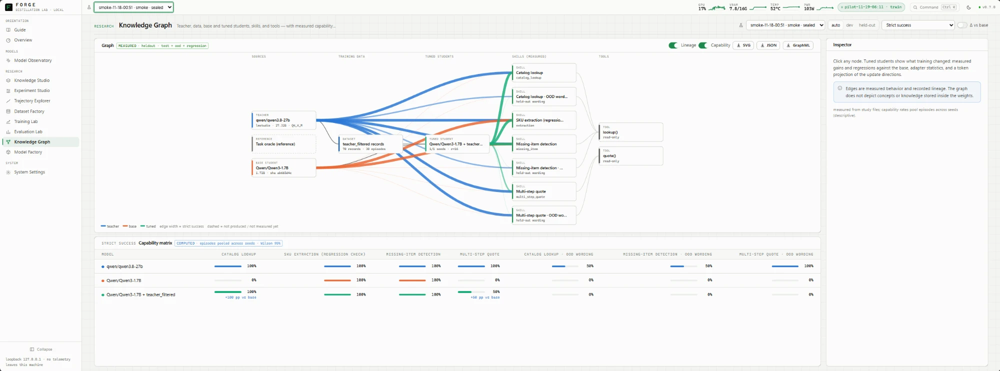
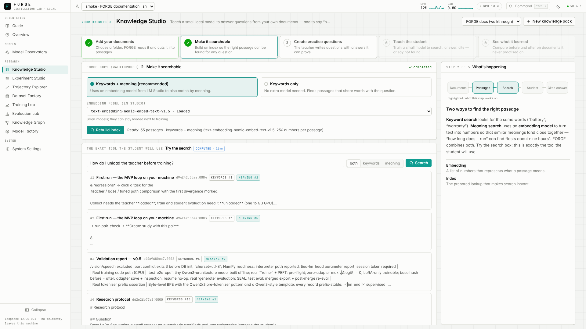

# FORGE — Local Distillation Lab (v0.7.0)

A local-first research instrument for **teacher → student LLM distillation on one consumer NVIDIA GPU**.
A large model you run in LM Studio (the *teacher*) solves tool-use or document-QA tasks. FORGE keeps only its
*verified* trajectories, trains a small Hugging Face model (the *student*) on them with LoRA, and then measures,
with paired statistics and confidence intervals, whether the student actually improved, where, and at what cost.

**One product, one backend, one UI, one port** (`127.0.0.1:8765`). Everything stays on your machine: loopback only,
no telemetry, original model weights are never modified.


<sub>Knowledge Graph from a real run (smoke profile, 1 seed: shows the wiring works, not a finding). Edge width = strict success per skill; green = the tuned student.</sub>

---

## Quick start (Windows 11 + NVIDIA GPU)

### 1. Prerequisites

| Need | Notes |
|---|---|
| Windows 11, NVIDIA GPU with **16 GB VRAM** (BF16-capable, e.g. RTX 40-series) | One GPU; the teacher and training take turns |
| **Python 3.12** | `winget install Python.Python.3.12` |
| **Node.js LTS** | `winget install OpenJS.NodeJS.LTS` (builds the UI) |
| **LM Studio** with its local server on `http://127.0.0.1:1234` | Serves the teacher (and, for Knowledge Studio, an embedding model) |
| A teacher model in LM Studio | e.g. a Qwen 14B–27B instruct model with tool use; avoid reasoning-first models (DeepSeek-R1) |

### 2. Install and launch (PowerShell, from this folder)

```powershell
.\scripts\probe-host.ps1                        # inspect the machine; installs nothing
.\scripts\setup.ps1 -WithML                     # backend\.venv, CUDA torch, pinned stack, UI deps, runs the tests
.\scripts\get-student.ps1 -Repo Qwen/Qwen3-1.7B # download a student (safetensors only, every shard verified)
.\scripts\verify-gpu.ps1                        # BF16 forward/backward check on the GPU
.\scripts\launch.ps1                            # build the UI and open http://127.0.0.1:8765
```

If PowerShell blocks the scripts, run `Set-ExecutionPolicy -Scope Process Bypass` in that window first.
If port 8765 is taken, FORGE exits and names the process using it (`.\scripts\launch.ps1 -Port 8766` to change it).
App state lives in `%LOCALAPPDATA%\Forge` (override with `FORGE_HOME`).

### 3. Your first study (about 15 minutes on a 16 GB GPU)

1. **Overview**: every Readiness row should be green (CUDA, BF16, venv, teacher endpoint).
2. **Model Observatory** → *Run discovery* → mark your LM Studio model as **teacher** and Qwen3-1.7B as **student** → *Pair builder* → run pair-check → **Create study with this pair**.
3. **Experiment Studio** → profile **smoke**, arm `teacher_filtered` → *Freeze plan & create*.
4. Run the stages in order:
   **Collect** (teacher *loaded*) → **Build** → **Unload LM Studio models** (button) → **Train** → **Eval · dev** → **Analyze · dev**
   → type `SEAL` → **Eval · test** → **Analyze · test**.
5. Read the results in **Evaluation Lab** (paired gain with 95 % CI), **Trajectory Explorer** (teacher / base / tuned paths with the first divergence marked), and **Knowledge Graph**.

*Smoke* only proves the pipeline works (2 training steps, 1 seed). To measure a real gain, create a **pilot** study (3 seeds, 3 epochs), then **research**.


### 4. Teach it your own documents: Knowledge Studio

Load an embedding model in LM Studio (e.g. `text-embedding-nomic-embed-text-v1.5`) next to the teacher, then open
**Knowledge Studio**. Five guided steps, each with a plain-language explanation beside it:

1. **Add your documents**: a folder of txt / md / rst / html / pdf, or FORGE's own docs as a sample. FORGE cuts them into passages.
2. **Make it searchable**: keyword search, optionally plus meaning search via the embedding model. The search box is the exact tool the student will use.
3. **Create practice questions**: the teacher writes questions whose answers are quoted from a passage, plus questions the documents cannot answer. Anything FORGE cannot verify is rejected, with the reason.
4. **Teach the student**: creates a doc-QA study and opens Experiment Studio to run the stages.
5. **See what it learned**: base vs tuned on documents the student never practised on, with each answer's search, retrieved passages, and cited source.


<sub>Validation instance using FORGE's own docs as the corpus and a stand-in embedding service.</sub>

**Use synthetic or non-sensitive documents only: no PHI, patient data, or secrets.** FORGE asks you to confirm this for every knowledge pack.

Full walkthrough: [docs/FIRST_RUN.md](docs/FIRST_RUN.md).

---

## Tips for larger, trustworthy gains

- Use **pilot** or **research** profiles; smoke shows roughly zero gain by design.
- Pick the teacher with the highest *strict success* on your tasks (a short collect per candidate), then keep it fixed for the study.
- More verified examples help (e.g. 200+ practice questions in Knowledge Studio).
- Choose settings on **dev** results only; seal once, then run **test** once. Report the seed confidence interval.

## What's inside

| Page | What it does |
|---|---|
| **Guide** | Concepts and the research protocol in plain language |
| **Overview** | Readiness for each stage of the loop, live GPU / VRAM / temperature / power telemetry |
| **Model Observatory** | Discovers LM Studio, Ollama, Hugging Face cache and folder models; parameter reconciliation; Hub search and download; teacher/student roles; pair-check with VRAM estimate |
| **Knowledge Studio** | Guided doc-QA workflow: documents → search index → verified questions → study |
| **Experiment Studio** | Frozen, hashed study plans; stages run as separate jobs with a live log and ETA |
| **Trajectory Explorer** | Every episode as an observable path; teacher / base / tuned comparison with first divergence |
| **Dataset Factory** | Per-arm training records, exclusions with reasons, token counts, provenance hashes |
| **Training Lab** | VRAM planning, pre-flight gates, zero-adapter check, loss curves, token exposure, peak memory |
| **Evaluation Lab** | Paired gain with crossed-bootstrap CI, sign-flip tests, Holm correction, skill map, review gate |
| **Knowledge Graph** | Teacher → data → tuned students → measured skills → tools; adapter statistics and token projection; SVG / JSON / GraphML export |
| **Model Factory** | What each adapter changed (measured from its weights), artifact provenance, and merged exports as new hashed copies; originals are never modified |
| **System Settings** | Runtime endpoints (loopback only), theme, accent, density, contrast, text scale, motion |


<details>
<summary>Feature detail by area</summary>

| Area | Delivered |
|---|---|
| Discovery | Ollama, LM Studio (files + REST, slug-matched; no duplicate rows), HF cache, folders, OpenAI-compatible endpoints; header-only GGUF/safetensors readers |
| Eligibility | Model kind (generative / encoder / embedding / vision / speech / seq2seq); non-generative models inventoried but hidden and role-ineligible; per-role checklists incl. license |
| Parameters | Stored vs. unique vs. non-embedding counts; tied `lm_head` duplicates detected |
| Engine | Seeded synthetic catalog tasks and doc-QA over knowledge packs; group/document-level splits; strict JSON action protocol; hidden-reasoning stripping |
| Knowledge | Ingest + chunking, BM25 + embedding hybrid search (RRF), teacher-written questions with verbatim-answer and leakage checks, verified unanswerable questions, citation-aware scoring |
| Datasets | Per-turn records, completion-only loss mask, exact token-prefix assertion, no truncation, shared eligible ids across arms, provenance hashes |
| Training | Transformers `Trainer` + PEFT LoRA (r16/α32, all-linear, bf16, grad-ckpt); each arm × seed in its own process; pre-flight gates; zero-adapter logit equality; base hash before = after |
| Statistics | Seed × group paired matrix, crossed bootstrap, exact/MC sign-flip, McNemar (diagnostic), Holm, power planner, review gate |
| Security | Loopback bind, Host allowlist, per-session token on mutations, loopback-only runtime endpoints, path confinement, `trust_remote_code=False`, `local_files_only=True` |

</details>

## Claims FORGE never makes

Broad reasoning transfer · clinical validity · deployment readiness · causal speed-ups across backends ·
"visualized chain of thought". A passing review gate means *candidate for human review*, nothing more.
See [docs/VALIDATION.md](docs/VALIDATION.md) for exactly what has and has not been executed.

## Developing

```powershell
.\scripts\test.ps1                 # backend test suite (154 tests)
.\scripts\launch.ps1 -Mode dev     # Vite dev server with hot reload
```

```
backend/forge/   api/ engine/ knowledge/ analysis/ graphs/ providers/ registry/ jobs/ security/ hardware/
backend/tests/   pytest suite (CPU-only end-to-end included)
frontend/src/    React 19 + TypeScript + Vite + Tailwind v4: lib/ components/ pages/
scripts/         probe-host setup get-student verify-gpu launch test
docs/            ARCHITECTURE  RESEARCH_PROTOCOL  FIRST_RUN  VALIDATION  WSL2  images/
```

Architecture: [docs/ARCHITECTURE.md](docs/ARCHITECTURE.md) · Research protocol: [docs/RESEARCH_PROTOCOL.md](docs/RESEARCH_PROTOCOL.md)
