# FORGE — Local Distillation Lab (v0.13.0)

A local-first research instrument for **teacher → student LLM distillation on one consumer NVIDIA GPU**.
A large model you run in LM Studio (the *teacher*) solves tool-use or document-QA tasks. FORGE keeps only its
*verified* trajectories, trains a small Hugging Face model (the *student*) on them with LoRA, and then measures,
with paired statistics and confidence intervals, whether the student actually improved, where, and at what cost.

**One product, one backend, one UI, one port** (`127.0.0.1:8765`). Everything stays on your machine: loopback only,
no telemetry, original model weights are never modified.


<sub>Knowledge Graph from a real run (smoke profile, 1 seed: shows the wiring works, not a finding). Edge width = strict success per skill; green = the tuned student.</sub>

---

## Quick start (Windows 11 + NVIDIA GPU)

### 1. Prerequisites

| Need | Notes |
|---|---|
| Windows 11, NVIDIA GPU with **16 GB VRAM** (BF16-capable, e.g. RTX 40-series) | One GPU; the teacher and training take turns |
| **Python 3.12** | `winget install Python.Python.3.12` |
| **Node.js LTS** | `winget install OpenJS.NodeJS.LTS` (builds the UI) |
| **LM Studio** with its local server on `http://127.0.0.1:1234` | Serves the teacher (and, for Knowledge Studio, an embedding model) |
| A teacher model in LM Studio | e.g. a Qwen 14B–27B instruct model with tool use; avoid reasoning-first models (DeepSeek-R1) |

### 2. Install and launch (PowerShell, from this folder)

```powershell
.\scripts\probe-host.ps1                        # inspect the machine; installs nothing
.\scripts\setup.ps1 -WithML                     # backend\.venv, CUDA torch, pinned stack, UI deps, runs the tests
.\scripts\get-student.ps1 -Repo Qwen/Qwen3-1.7B # download a student (safetensors only, every shard verified)
.\scripts\verify-gpu.ps1                        # BF16 forward/backward check on the GPU
.\scripts\launch.ps1                            # build the UI and open http://127.0.0.1:8765
```

If PowerShell blocks the scripts, run `Set-ExecutionPolicy -Scope Process Bypass` in that window first.
If port 8765 is taken, FORGE exits and names the process using it (`.\scripts\launch.ps1 -Port 8766` to change it).
If setup fails with **`No module named 'pip._vendor'`** (or any broken-pip error), the project venv is damaged — usually an interrupted upgrade, antivirus quarantine, or a new copy of FORGE unpacked over an old `backend\.venv`. Setup now repairs it automatically; to force a clean rebuild run `.\scripts\setup.ps1 -WithML -Recreate`.
App state lives in `%LOCALAPPDATA%\Forge` (override with `FORGE_HOME`).

### 3. Your first study (about 15 minutes on a 16 GB GPU)

FORGE opens on **Home**: one card per project with its progress and next step, quick starts, and a guided tour for your role. Use the *Simple / Expert* switch (sidebar or Home) to show the expert pages. Before long runs, check **Settings → Hardware guard** (thermal pause, CPU cores kept free, low priority).

1. **System Overview** (Expert mode): every Readiness row should be green (CUDA, BF16, venv, teacher endpoint).
2. **Model Observatory** → *Run discovery* → mark your LM Studio model as **teacher** and Qwen3-1.7B as **student** → *Pair builder* → run pair-check → **Create study with this pair**.
3. **Experiment Studio** → profile **smoke**, arm `teacher_filtered` → *Freeze plan & create*.
4. Run the stages in order:
   **Collect** (teacher *loaded*) → **Build** → **Unload LM Studio models** (button) → **Train** → **Eval · dev** → **Analyze · dev**
   → type `SEAL` → **Eval · test** → **Analyze · test**.
5. Read the results in **Evaluation Lab** (paired gain with 95 % CI), **Trajectory Explorer** (teacher / base / tuned paths with the first divergence marked), and **Knowledge Graph**.

*Smoke* only proves the pipeline works (2 training steps, 1 seed). To measure a real gain, create a **pilot** study (3 seeds, 3 epochs), then **research**.

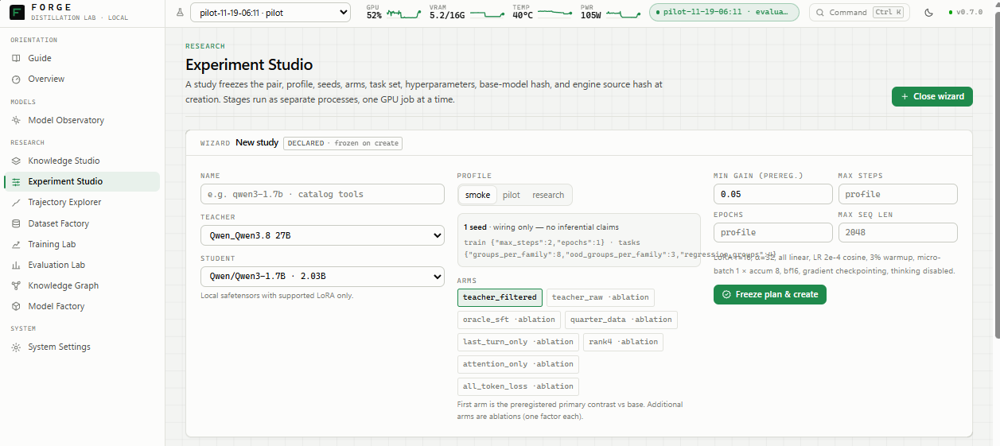

### 4. Teach it your own documents: Knowledge Studio

Load an embedding model in LM Studio (e.g. `text-embedding-nomic-embed-text-v1.5`) next to the teacher, then open
**Knowledge Studio**. Five guided steps, each with a plain-language explanation beside it:

1. **Add your documents**: a folder of txt / md / rst / html / pdf, or FORGE's own docs as a sample. FORGE cuts them into passages.
2. **Make it searchable**: keyword search, optionally plus meaning search via the embedding model. The search box is the exact tool the student will use.
3. **Create practice questions**: the teacher writes questions whose answers are quoted from a passage, plus questions the documents cannot answer. Anything FORGE cannot verify is rejected, with the reason.
4. **Teach the student**: creates a doc-QA study and opens Experiment Studio to run the stages.
5. **See what it learned**: base vs tuned on documents the student never practised on, with each answer's search, retrieved passages, and cited source.


<sub>Validation instance using FORGE's own docs as the corpus and a stand-in embedding service.</sub>

**Use synthetic or non-sensitive documents only: no PHI, patient data, or secrets.** FORGE asks you to confirm this for every knowledge pack.

Full walkthrough: [docs/FIRST_RUN.md](docs/FIRST_RUN.md).

---

### 5. Build a purpose-built agent: Agent Studio

Open **Agent Studio** and follow the five steps:

1. **Define the agent**: start from a starter template or blank; write its role (what it does, what it must never do). Templates (all synthetic):
   - *IT service desk*: ServiceNow-style routing, priority from impact × urgency, CMDB enrichment, SLA due dates, major-incident rule
   - *Patient access*: request and referral routing, clinic and location, scheduling windows, administrative expedite rule (no clinical triage)
   - *Pharmacy benefits*, *Claims denials* (revenue cycle), *Prior authorization criteria*, *Security alert triage* (defensive, MITRE ATT&CK)
2. **Give it tools**: add your tables (CSV / JSON; scanned and refused if they look like personal data), switch on the exact calculator, unit conversion and date arithmetic, define yes/no **rules** (e.g. "review if tier ≥ 4 or quantity > 90"), optionally link a Knowledge Studio pack. Try any tool in the console.
3. **Describe skills**: a name, one sentence, the tools it may use, a few examples, and an optional share of not-found cases.
4. **Practice tasks**: the teacher writes many more — or, for template skills, the built-in **template generator** writes them in seconds with no teacher. Either way FORGE re-runs every tool call and keeps only tasks it can prove. Rejections are listed with reasons.
5. **Teach & measure**: pick focus skills, create the study, run the stages, then open the Distillation Lens.

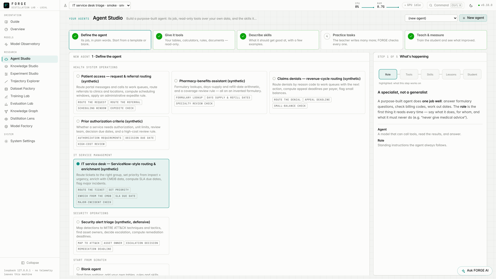

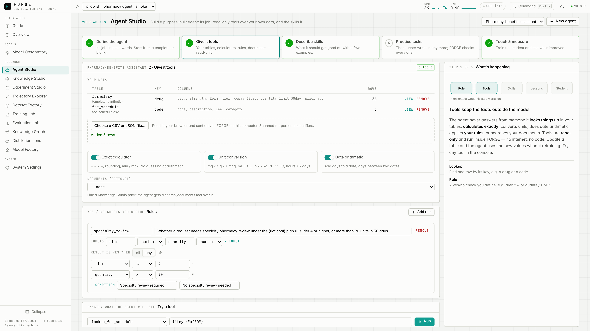
<sub>Validation instance: synthetic template plus a synthetic fee schedule.</sub>

**Find your way:** pages are grouped into workspaces (Build · See inside & control · Measure · Operate) with tabs across the top of each page; the **Model Hub** gathers everything about one model, and **Inspect** (or `.`) shows the active study and model from anywhere. Design and accessibility rules: [docs/DESIGN.md](docs/DESIGN.md).

**Test any model:** **Measure → Bench Lab** runs computation, vision (synthetic documents) and security (blue team) benches on LM Studio models, local students and trained adapters. See [docs/BENCH.md](docs/BENCH.md).

**Faster training:** FORGE Turbo switches (fused kernels, 4-bit QLoRA, 8-bit optimizer, activation offload, packing) — set them when creating a study, or re-train a study with other settings and compare engines on identical data in **Training Lab**. See [docs/TURBO.md](docs/TURBO.md).

**Loading your own data:** download a template's table as CSV, fill it in the same shape and load it. See [docs/LOADING_DATA.md](docs/LOADING_DATA.md) (prior authorization worked example). After the first evaluation, check **Evaluation Lab → Is this a good test?** before reading any gain.

### 6. See it and control it: Agent Playground, Weight Lab, human review

- **Agent Playground**: type a message (or pick a practice task) and watch the untrained student, trained students, Weight Lab
  variants and the teacher handle it side by side — every tool call, the evidence behind each answer, and where each model first
  differs from the teacher. A person **accepts** or **overrides** each recommendation; overrides can become new examples.
- **Weight Lab**: build new adapters from trained ones without retraining — change **strength** (0 = untrained, 1 = as trained,
  >1 = amplified), **mix** adapters (average seeds, or merge skills from different agents; the sum is exact), keep only some
  **layers / module types**, or **compress the rank**. Measure each variant on dev tasks against the untrained and trained student
  and the teacher, skill by skill, then try it in the Playground. Sources and base weights are never changed.
- **Human review** (Agent Studio → Practice tasks → *Human review*): approve, correct (re-verified against the tools) or reject
  each practice task, with the reviewer's name. Studies can be told to **teach only reviewed tasks**.

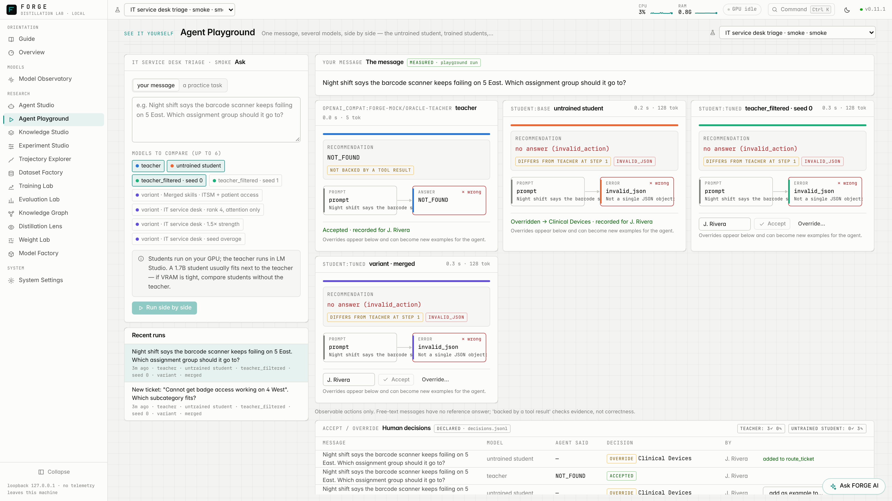

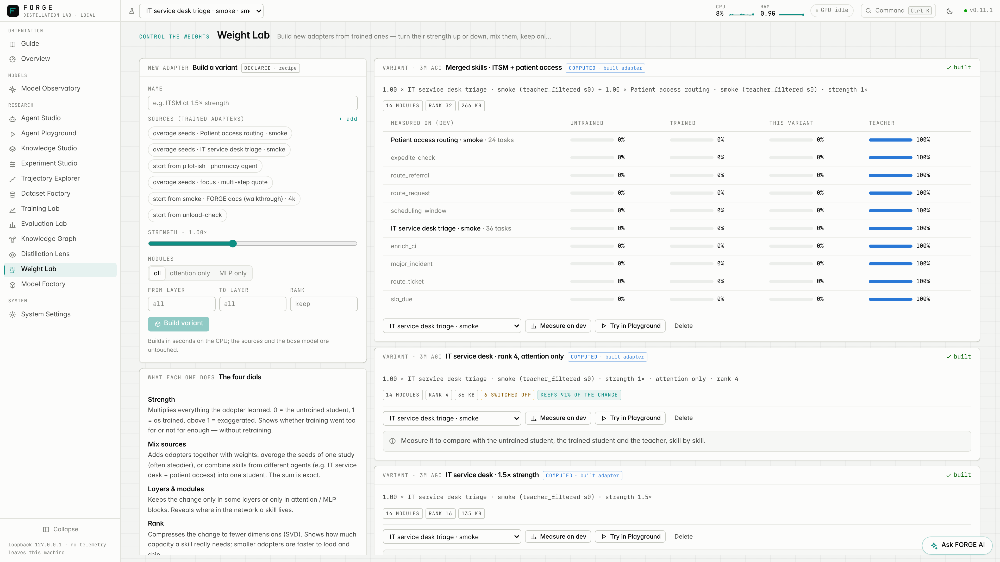
<sub>Validation instance: tiny CPU student and a mock teacher — the instruments working, not learning results.</sub>

### 7. See how a model is organised: Model Map

Three linked, measured views of the same tasks:
- **Decision graph**: every episode of one model merged into *skill → action → action → … → outcome*; line width = number of tasks.
  Per skill it reports how consistently the model follows one procedure. Click a step to follow its tasks.
- **Representation map**: the student's internal state at the moment it decides, for every task, at every layer — untrained and
  trained side by side on shared axes, coloured by skill, with cluster quality (skill purity, silhouette) by layer. Drag the layer
  slider to watch skills separate; click a point to open it in the word view.
- **Word view**: which words of the message pushed the student's first action (gradient × input), and what each layer would have
  predicted at the decision point (logit lens).

These are measurements of behaviour and activations. FORGE does not draw a "chain of thought": a model's written reasoning is
generated text, not a trace of its computation.

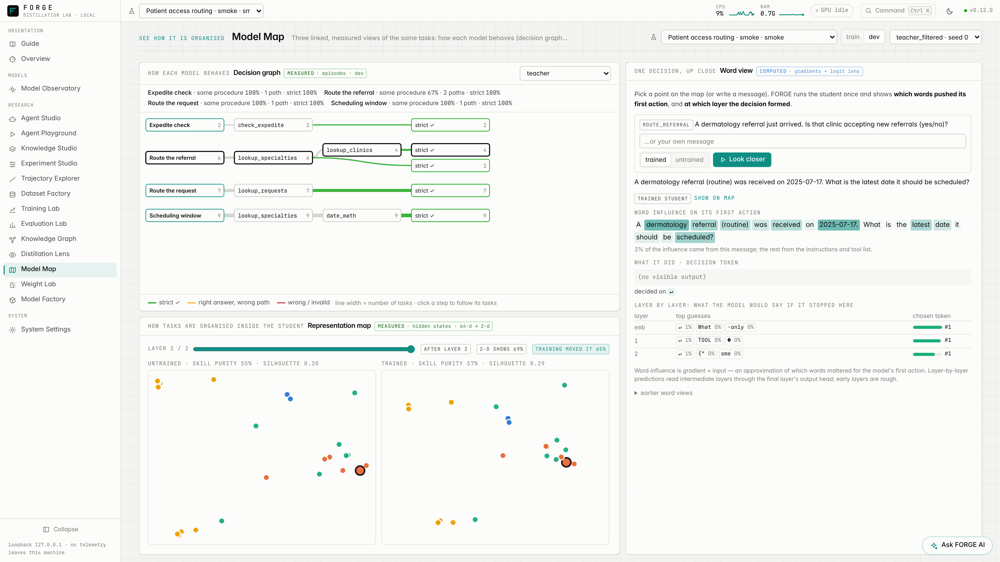
<sub>Validation instance: tiny 2-layer CPU student — the instrument working, not a learning result.</sub>

### 8. Know the limits: boundaries, stress tests, data needs

1. **Agent Studio → Practice tasks → Boundaries**: turn on *Include boundary cases*, pick categories, add your own "must hand back" requests, save, and write the tasks again. Check **Tasks → Coverage map** for thin skills or one answer dominating.
2. Run the study as usual, then open **Measure → Robustness & limits**:
   - **Boundaries**: share of hand-back cases the model got right, and how often it wrongly handed back an ordinary task.
   - **Stress tests**: the same practice tasks with typos, casual wording, irrelevant text and hidden instructions.
   - **How much data?**: dev success at 10 / 25 / 50 / 100 % of the training tasks. Still climbing means more examples will help.

### 9. Try it in LM Studio: GGUF export

After SEAL, test analysis and **Export**: clone llama.cpp (`git clone https://github.com/ggml-org/llama.cpp`; build it if you want 4–6-bit files), set its folder in **Model Factory → GGUF for LM Studio**, choose q8_0 (recommended) and *Make GGUF*. The file lands in LM Studio's models folder under `forge/`. Load it in LM Studio, enter its model id and run the **test-set check** to see how much conversion changed behaviour. **Robustness & limits → Efficiency** shows time, tokens, energy and sizes.

### 10. Governance: model card, audit trail, reports

Type your name once (Governance page or any review panel) so your actions are recorded with it. **Measure → Governance** shows the model card, how the model fails and what training fixed or broke, whether it knows when it doesn't know, per-skill curves, and a hash-checked timeline of who did what. **Reports** produces a printable HTML report for executives, operations / clinical reviewers, or technical staff.

### 11. Optional: auto-tune with Azure OpenAI

With the AI assistant configured (next section), **Weight Lab → Auto-tune with Azure** lets your Azure model propose weight edits round by round; you approve each, FORGE builds and measures it on practice tasks. It runs through FORGE's own API, so you can drive the same loop from a script. See [docs/AUTOTUNE.md](docs/AUTOTUNE.md).

### 12. Optional: AI assistant (Azure OpenAI)

Off and invisible until you configure it. In **System Settings → Integrations → Set up Azure OpenAI** enter your resource
endpoint (`https://<resource>.openai.azure.com`), the chat deployment name, and the **name** of the environment variable that holds
your key (default `AZURE_OPENAI_API_KEY`). FORGE never stores the key. Set it for your user and restart FORGE:

```powershell
setx AZURE_OPENAI_API_KEY "<key from Azure portal → Keys and Endpoint>"
```

Then **Test connection**. An **Ask FORGE AI** button appears on every page, plus *Explain with AI* / *Interpret with AI* /
*Why rejected?* / *Improve examples* buttons where they help. The assistant knows FORGE's methods and answers from your actual
study, agent or knowledge pack.

- **Summaries are sent when you ask**: metrics, settings, statistics, skill and tool names.
- **Real text is sent only after you review it**: tasks, examples, table rows, passages and episodes are shown in a review dialog;
  FORGE sends exactly that payload, checked by hash.
- File paths are removed, anything resembling personal data is refused, and a local audit log records what was sent.

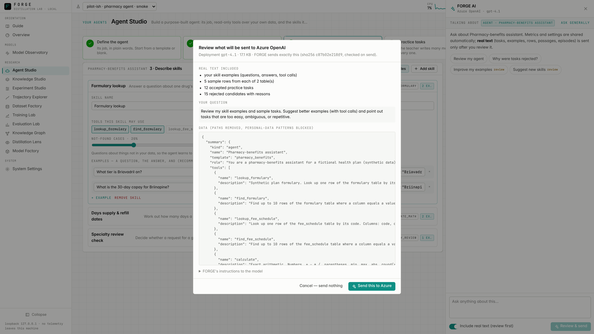
<sub>Validation instance with a mock Azure endpoint.</sub>

## Tips for larger, trustworthy gains

- Use **pilot** or **research** profiles; smoke shows roughly zero gain by design.
- Pick the teacher with the highest *strict success* on your tasks (a short collect per candidate), then keep it fixed for the study.
- More verified examples help (e.g. 200+ practice questions in Knowledge Studio).
- **Focus on the skills you care about**: pick *Focus skills* in the study wizard (or "What should it get better at?" in Knowledge Studio). Training uses only those skills; every skill is still evaluated, so side effects show up.
- Use the **Distillation Lens** to check training is still moving the student toward the teacher before adding steps or data.
- Choose settings on **dev** results only; seal once, then run **test** once. Report the seed confidence interval.

## What's inside

| Page | What it does |
|---|---|
| **Home** | Projects (agents, document sets, built-in catalog) with stage progress, latest results and next step; quick starts; role tours; glossary |
| **Robustness & limits** | Boundary suite (hand-back held vs over-refusal), stress tests (typos, wording, noise, hidden instructions), and the "how much data?" curve |
| **Model Hub** | One page per model: capabilities, best measured scores with ranges, bench results, trained adapters, studies, variants, exports, next actions |
| **Bench Lab** | Exact-answer benches for any model: computation (on its own vs with tools), document images (vision), and blue-team security analysis; cross-model scorecard |
| **Governance** | Model card, failure types, knows-its-limits calibration, per-skill curves, audit trail (who did what), one-click reports for executives / operations / technical staff |
| **Learn** | Role-based learning paths: hands-on lessons with a self-check each |
| **Guide** | Concepts and the research protocol in plain language |
| **Overview** | Readiness for each stage of the loop, live GPU / VRAM / temperature / power telemetry |
| **Model Observatory** | Discovers LM Studio, Ollama, Hugging Face cache and folder models; parameter reconciliation; Hub search and download; teacher/student roles; pair-check with VRAM estimate |
| **Agent Studio** | Guided builder for purpose-built agents: role, read-only tools over your data (tables, exact calculator, units, dates, rules, documents), skills with examples, verified practice tasks, focus-skill studies |
| **Knowledge Studio** | Guided doc-QA workflow: documents → search index → verified questions → study; a *Map of meaning* shows every passage and question in embedding space with the student's real search results |
| **Experiment Studio** | Frozen, hashed study plans, optional focus skills; stages run as separate jobs with a live log and ETA |
| **Trajectory Explorer** | Every episode as an observable path; teacher / base / tuned comparison with first divergence |
| **Dataset Factory** | Per-arm training records, exclusions with reasons, token counts, provenance hashes |
| **Training Lab** | VRAM planning, pre-flight gates, zero-adapter check, loss curves, token exposure, peak memory |
| **Evaluation Lab** | Paired gain with crossed-bootstrap CI, sign-flip tests, Holm correction, skill map, review gate |
| **Knowledge Graph** | Teacher → data → tuned students → measured skills → tools; adapter statistics and token projection; SVG / JSON / GraphML export |
| **Agent Playground** | One message through several models side by side (tool calls, evidence, divergence from the teacher); human accept / override, overrides become examples |
| **Model Map** | Decision graph of observable actions, per-layer representation map (untrained vs trained, cluster quality), word influence and layer-by-layer predictions for one decision |
| **Weight Lab** | Exact adapter arithmetic: strength, seed averaging, skill merging, layer / module masks, rank compression; dev evaluation per skill; originals untouched |
| **Distillation Lens** | Skill space (each skill: untrained → trained vs teacher, gap closed); distance to the teacher over training (teacher-forced surprise and top-1 agreement at saved snapshots); word heatmap of which teacher tokens the student learned to expect |
| **Model Factory** | What each adapter changed (measured from its weights), artifact provenance, and merged exports as new hashed copies; originals are never modified |
| **System Settings** | Runtime endpoints (loopback only), theme, accent, density, contrast, text scale, motion |

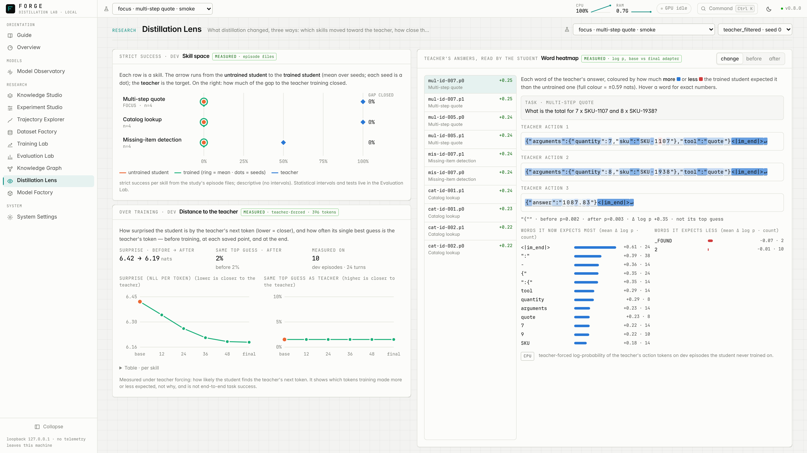
<sub>Distillation Lens on a validation run (tiny random-weight CPU student, mock teacher): shows the instrument working, not a learning result.</sub>

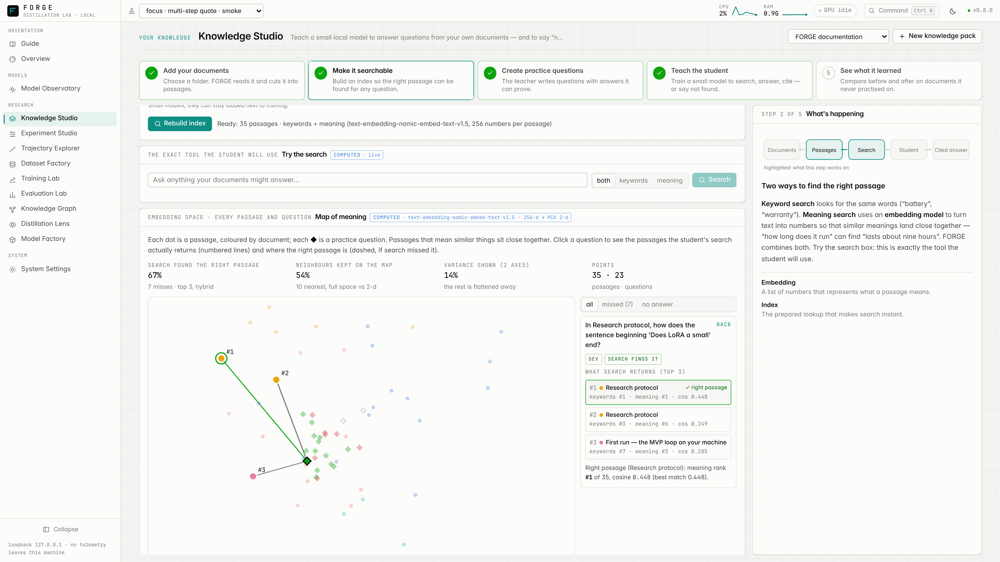
<sub>Map of meaning on FORGE's own docs with a stand-in embedding service.</sub>

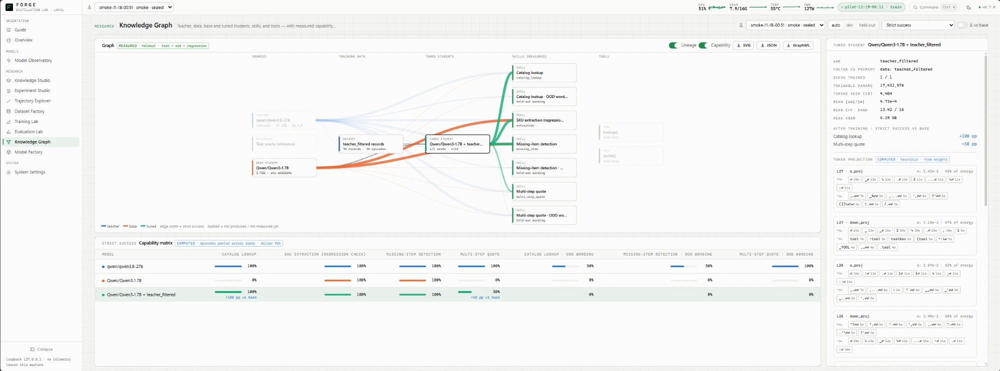

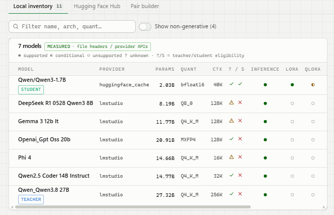

<details>
<summary>Feature detail by area</summary>

| Area | Delivered |
|---|---|
| Discovery | Ollama, LM Studio (files + REST, slug-matched; no duplicate rows), HF cache, folders, OpenAI-compatible endpoints; header-only GGUF/safetensors readers |
| Eligibility | Model kind (generative / encoder / embedding / vision / speech / seq2seq); non-generative models inventoried but hidden and role-ineligible; per-role checklists incl. license |
| Parameters | Stored vs. unique vs. non-embedding counts; tied `lm_head` duplicates detected |
| Engine | Seeded synthetic catalog tasks and doc-QA over knowledge packs; group/document-level splits; strict JSON action protocol; hidden-reasoning stripping |
| Knowledge | Ingest + chunking, BM25 + embedding hybrid search (RRF), teacher-written questions with verbatim-answer and leakage checks, verified unanswerable questions, citation-aware scoring |
| Datasets | Per-turn records, completion-only loss mask, exact token-prefix assertion, no truncation, shared eligible ids across arms, provenance hashes |
| Training | Transformers `Trainer` + PEFT LoRA (r16/α32, all-linear, bf16, grad-ckpt); each arm × seed in its own process; pre-flight gates; zero-adapter logit equality; base hash before = after |
| Statistics | Seed × group paired matrix, crossed bootstrap, exact/MC sign-flip, McNemar (diagnostic), Holm, power planner, review gate |
| Security | Loopback bind, Host allowlist, per-session token on mutations, loopback-only runtime endpoints, path confinement, `trust_remote_code=False`, `local_files_only=True` |

</details>

## Claims FORGE never makes

Broad reasoning transfer · clinical validity · deployment readiness · causal speed-ups across backends ·
"visualized chain of thought". A passing review gate means *candidate for human review*, nothing more.
See [docs/VALIDATION.md](docs/VALIDATION.md) for exactly what has and has not been executed.
Security and robustness controls, with how each is checked: [docs/HARDENING.md](docs/HARDENING.md). Release history: [CHANGELOG.md](CHANGELOG.md).

## Developing

```powershell
.\scripts\test.ps1                 # backend test suite (190 tests)
.\scripts\launch.ps1 -Mode dev     # Vite dev server with hot reload
```

```
backend/forge/   api/ engine/ knowledge/ analysis/ graphs/ providers/ registry/ jobs/ security/ hardware/
backend/tests/   pytest suite (CPU-only end-to-end included)
frontend/src/    React 19 + TypeScript + Vite + Tailwind v4: lib/ components/ pages/
scripts/         probe-host setup get-student verify-gpu launch test
docs/            ARCHITECTURE  RESEARCH_PROTOCOL  FIRST_RUN  VALIDATION  WSL2  images/
```

Architecture: [docs/ARCHITECTURE.md](docs/ARCHITECTURE.md) · Research protocol: [docs/RESEARCH_PROTOCOL.md](docs/RESEARCH_PROTOCOL.md)
